# KodeKit layouts and widgets of the modern layout

KodeKit's first widgets copy IMGUI: rows, panels, sections, scroll lists, toggles, arrow selectors. The classic layout uses
them, so its windows look and work like MechJeb's IMGUI windows. The **modern layout**, the default, adds the widgets and layouts
below. Views use them only when the setting is on. Everything is built in code (no asset bundle), follows the theme, and makes no
garbage per frame once built.

Screenshots come from the gallery test (`MechJeb2_UI/Spike15-Gallery`, run 2026-10-29: KSP 1.12.5, 1920×1080, at MechJeb's
COMPACT spacing, over the main menu). Each widget is shown in its own window. The widget sections show the Flat skin; the
Skins and Segmented sections show all four.

## Settings

The new UI's Settings window has four settings for this. All are saved globally (`MechJebModuleSettings`).

| Setting | Field | Values | Effect |
|---|---|---|---|
| New UI skin | `UiSkin` | Classic, Flat (default), Glass, ZTheme | The look (see Skins). It applies to every new-UI window at once, without a rebuild. |
| Compact | `UiCompact` | on (default) / off | Tighter margins and rows, in every skin (`Theme.Compact`). MechJeb's IMGUI skin no longer decides this. A custom window's own Compact switch can follow it, or override it on or off. |
| Modern layout | `UiModernLayout` | on (default) / off | Views build with the widgets below instead of IMGUI's. Changing it rebuilds the open windows. |
| Section headers | `UiSectionHeaders` | on (default) / off | The headers the modern layout adds to long windows (`KodeWindow.Header`). |

`KodeHost` passes them to KodeKit's statics before it builds the windows: `KodeWindow.ModernLayout` and
`KodeWindow.ShowHeaders`. `KodeHost.ThemeFor(skin, compact, opacity)` builds a skin's theme. Tests use the same call.

The choice style is not a setting. Each choice picks its own, by the rule under Segmented. A **Choices** setting was
used to compare the three styles window by window, then dropped (2026-10-30).

## Skins

`Theme.Classic`, `Theme.Flat`, `Theme.Glass` and `Theme.ZTheme` derive from the base theme (KSP's stock sprites,
LiberationSans 13 px, MechJeb's row heights). Each sets the accent colour, the header colour, the hairline (`Rule`) colour,
and the `Primary` / `Danger` / `Selected` button styles. Flat, Glass and ZTheme also replace every sprite with rounded boxes
drawn in code (`Sprites.RoundedBox`, 9-sliced at the corner radius, cached per parameters). The window opacity setting goes
into the window tint's alpha.

**Classic**

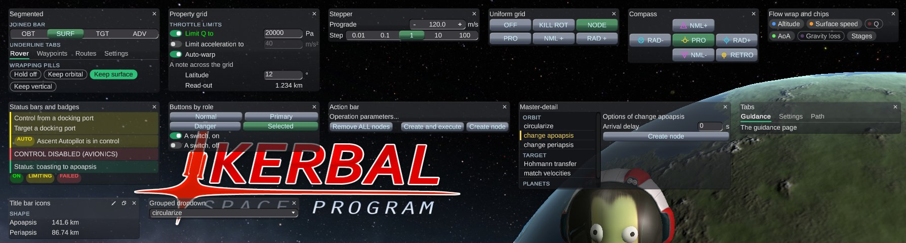

**Flat**

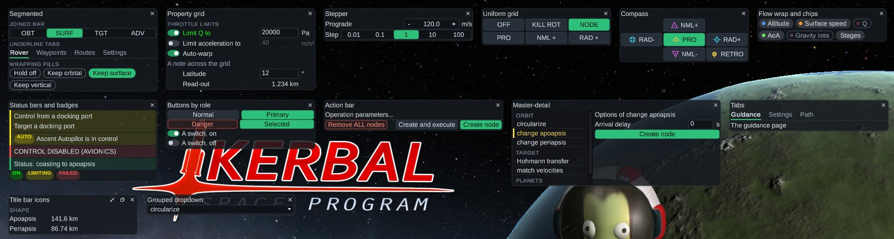

**Glass**

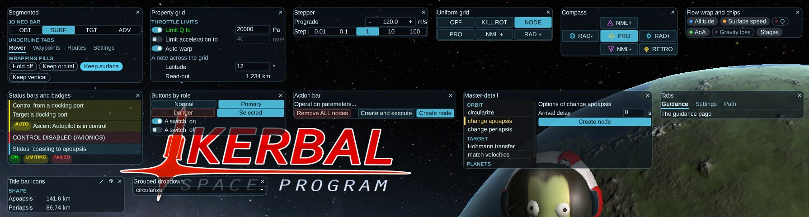

- **Classic**: KSP's sprites, with its own accent colour. Main buttons are tinted blue, destructive ones red, and selected
  choices green, as in IMGUI's selection grids.
- **Flat**: solid dark panels with 4 to 7 px corners and one green accent.
- **Glass**: translucent panels with cyan outlines, close to KSP's navball and map HUD.
- **ZTheme**: purple-tinted dark greys and a green accent, the colours of the ZTheme mod (github.com/zapSNH/ZTheme). It
  doesn't need that mod.

## Layouts

Three uGUI layout groups, in `LayoutGroups.cs`:

| Group | What it does |
|---|---|
| `UniformGridLayout` | Rows of N cells, all the same size: the widest child's width and the tallest child's height. Spare room is shared equally. |
| `FlowLayout` | Children left to right at their preferred size, wrapping to a new line. It asks only for its widest child's width (or `LineWidth`), so it never widens a window to fit everything on one line. |
| `TableLayout` + `TableRow` | Rows of cells in shared columns. Each column is as wide as its widest cell, and `FlexibleColumn` takes the room left over. A row of one cell spans the table. A hidden cell keeps its column. |

They reuse their lists from one layout pass to the next and make no garbage when a window lays itself out again.

### UniformGrid

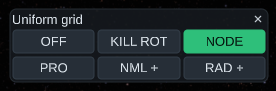

Every cell has the same size, whatever its label. Used by the SmartASS targets (OFF / KILL ROT / NODE, the SURF and TGT
targets), the SmartRcs targets and the joined choice bar.

```csharp
Layout grid = KodeWindow.UniformGrid(parent, columns: 3);
UIButton b = KodeWindow.Button(grid, "PRO", () => ss.target = Target.PROGRADE, true);
w.BindRole(b, () => ss.target == Target.PROGRADE ? ButtonRole.Selected : ButtonRole.Normal);
```

### Compass

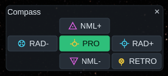

Up to eight cells around a centre, in a 3×3 uniform grid. Used by the SmartASS navball cross (normal up, anti-normal down,
radial in and out at the sides, prograde in the centre, retrograde in a corner, each with its navball marker), and by the
Landing Guidance 10 m nudge pad.

```csharp
KodeWindow.CompassGrid c = KodeWindow.Compass(parent, cell: 20);
KodeWindow.IconButton(c[Dir.N], Sprites.Arrow(Sprites.Direction.Up), () => Move(true, 10));
KodeWindow.Label(c[Dir.C], "10m");
```

`Sprites.NavballMarker(marker)` draws KSP's six orbital markers in white. `Sprites.MarkerColor(marker)` gives each one's
navball colour.

### FlowWrap

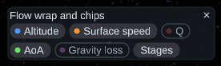

Children wrap to the window's width. Used by the Flight Recorder legend (16 series chips), the Delta-V stats options, and
the pill style of choices.

```csharp
Layout chips = KodeWindow.FlowWrap(parent, spacing: 4);
w.Chip(chips, "Altitude", () => g.displayed[i], v => g.displayed[i] = v, seriesColor);
```

### PropertyGrid

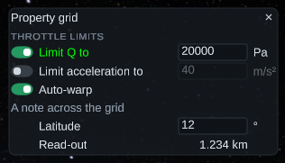

Option rows in shared columns, `[switch] label [field] unit`, so the fields of a block line up. A row whose switch is off
dims its field and unit. Used by Utilities, Ascent Settings (thrust limits, steering, autostage), PSG Settings, Landing
Guidance (autopilot options), Docking Autopilot and the Node Editor (with steppers in the field column).

```csharp
KodeWindow.PropertyGrid g = w.Properties(parent);
g.Switch("#MechJeb_Ascent_checkbox11", () => t.LimitDynamicPressure, v => t.LimitDynamicPressure = v,
    () => t.MaxDynamicPressure.Text, s => t.MaxDynamicPressure.Text = s, 70, "Pa", () => t.MaxDynamicPressure.IsParsed,
    LimiterTones.For(t, LimitMode.DYNAMIC_PRESSURE));  // the label turns green while limiting
g.Field("Min Coast", () => p.MinCoast.Text, s => p.MinCoast.Text = s, 50, "s");
g.Value("Apoapsis", ApoapsisText);
g.Note("Stage fairings when:");                    // one cell across the grid
Layout row = g.Row();                              // any cells, in column order
g.Dim(fieldGo, unitGo, () => !enabled);            // fade cells while a condition holds
g.FlexibleColumn = 0;                              // for label | control | unit rows, without a switch
```

`MuMech.UI.ModernRows` builds the thrust limiter and autostage blocks that several windows share. On MechJeb's editables,
`EditUi.Grid(g, label, () => editable, unit, width)` is the field row (red while the text does not parse).

### MasterDetail

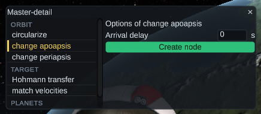

A scroll list on the left, the selected item's details on the right. Consecutive items of the same group are listed under
its header. Meant for the Maneuver Planner's operations, waypoint routes and the Custom Window Editor. The planner uses the
grouped dropdown for now (proposal 6A).

```csharp
Layout detail = w.MasterDetail(parent, listWidth: 160, height: 150, ops.Length, i => ops[i].GetName(), i => GroupName(i),
    () => planner.OperationId, i => planner.OperationId = i);
```

### Tabs

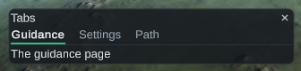

One window, several pages: underlined tabs over one panel per page, with only the selected panel shown. Without get/set,
the window keeps the selection itself.

```csharp
Layout[] pages = w.Tabs(parent, new[] { "Guidance", "Settings", "Path" });
```

### ActionBar

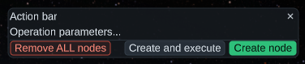

The bottom of a window, under a hairline: destructive actions on the left, the others on the right, the primary action
last. Used by the Maneuver Planner.

```csharp
KodeWindow.ActionBarRow bar = KodeWindow.ActionBar(parent);
bar.Danger("#MechJeb_Maneu_button3", RemoveAllNodes);
bar.Normal("#MechJeb_Maneu_button2", () => CreateNodes(true));
bar.Primary("#MechJeb_Maneu_button1", () => CreateNodes(false));
```

## Widgets

### Segmented (one choice out of several)

Each window shows the three styles, top to bottom: joined bar, underline tabs, wrapping pills.

| Classic | Flat | Glass |
|---|---|---|
| 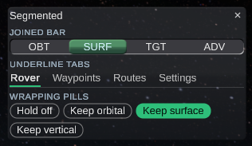 | 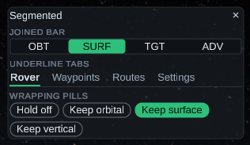 | 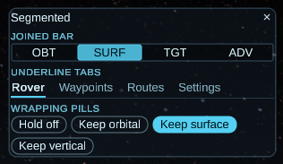 |

One control for "exactly one of these". It replaces SelectionGrid rows and sets of checkboxes that act as one choice.

**Which style:**

- **Tabs for navigation.** A navigation choice only changes what the window shows; picking one does nothing to the
  vessel or the settings.
- **Joined for the rest:** modes, settings and values.
- **Pills** stay in KodeKit but no MechJeb window uses them.

```csharp
w.Segmented(parent, modeKeys, () => (int)ss.mode, i => ss.mode = (Mode)i, ChoiceStyle.Tabs);   // navigation
w.Segmented(parent, labels, get, set);                                                          // Joined, the default
```

In the windows (Flat; Spike 9 run modern3):

| SmartASS: mode as tabs | Waypoint Help: topics as tabs | Translatron: mode as a joined bar |
|---|---|---|
| 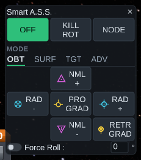 | 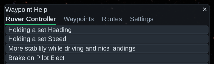 | 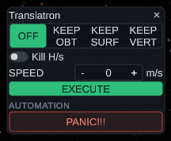 |

| Tabs (navigation) | Joined |
|---|---|
| SmartASS mode (OBT, SURF, TGT, ADV: it only switches which targets are shown), Waypoint Help topics, `Tabs()` pages | Translatron modes, attitude controller, Node Editor conics mode and step, Flight Recorder Downrange / Time, Maneuver Planner create / change, PSG coast location, Landing N/S and E/W, Delta-V display set (a saved column preset) |

### Switch and SwitchRow

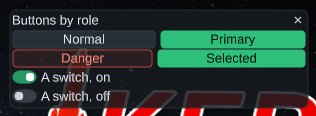

An on/off switch: a pill track in the accent colour, with a knob that moves. `SwitchRow` puts the switch on the **left**
of its label (proposal 4A, switch on the left), and a click on the label flips it too.

```csharp
w.SwitchRow(parent, "#MechJeb_NodeEd_checkbox1", () => core.Node.Autowarp, v => core.Node.Autowarp = v);
```

### Switch3 (three positions)

A switch with a knob at the left, middle or right, for a setting that can follow something else: off, follow, on. The position's
name sits beside it, and a click on a third of the track moves the knob there. The right position takes the accent colour.

```csharp
w.Switch3(row, names, () => (int)edited.Compact, v => edited.Compact = (MechJebModuleCustomInfoWindow.CompactMode)v);
```

### Stepper

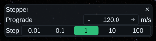

A value and its nudges as one control: `[−][value][+]`. − and + add ∓step(), ×10 with Shift held. With `repeat`, they
repeat while held. The step is a separate choice, made once (a "Step" segmented row) instead of a step field on every
axis. The buttons are at least a row high and wide: IMGUI's 15 px buttons are too small to hit.

```csharp
w.Stepper(row, () => ed.prograde.Text, s => ed.prograde.Text = s, d => { ed.prograde = ed.prograde + d; ed.UpdateNodeFromFields(); },
    () => ed.progradeDelta, 70, () => ed.prograde.IsParsed, repeat: true);
```

Where: Node Editor axes and time shift, Rover heading and speed, Translatron speed, planner lead time.

### Chip

An on/off pill with an optional colour dot: filled when on, outlined and dim when off. Used by the Flight Recorder legend
and the Delta-V stats options. Shown in the Flow wrap screenshot.

### Badge and StatusBar

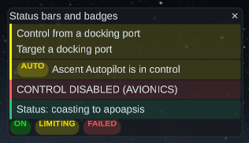

A badge is a small upper-case pill of text in a tone's colour. A status bar is a strip across the window, with a coloured
edge, a tint of the same colour, and any rows inside it. The tone is read every frame.

- **At the bottom**, it says who is in control. SmartASS, SmartRcs and Translatron keep their body in view, greyed and
  inert, with an "AUTO" badge and the controlling module's name (`GuidanceUi.AutoBar`). Also used for the landing,
  docking, ascent and autostage status.
- **At the top**, it lists what is wrong. The Docking Autopilot's three setup problems go in one bar at the top, where
  IMGUI showed them.
- Warnings: PSG Qα limit, planner operation errors, differential throttle, "CONTROL DISABLED".

```csharp
Layout bar = w.StatusBar(parent, () => KodeWindow.Tone.Warn);
w.Visible(GuidanceUi.Wrapped(bar, "#MechJeb_Docking_label2").gameObject, () => noDockingPortControl);
```

### Buttons by role

`ButtonRole.Normal`, `Primary` (the main action), `Danger` (destructive) and `Selected` (a chosen option). Each role has
its own style in Flat, Glass and ZTheme. Classic tints the stock button for each role. Use `w.BindRole(button, () => role)`
for a role that follows a state, such as a state button that turns Selected while its mode is on.

A fixed role (`Button(..., role)` or `KodeWindow.Role(button, role)`) only shows in the modern layout: the classic layout
keeps IMGUI's plain buttons, so a view builds the same buttons in both. `BindRole` applies in both layouts.

```csharp
KodeWindow.Button(parent, "#MechJeb_NodeEd_button6", () => core.Node.Abort(), ButtonRole.Danger, true);
```

### Text colours (tones)

`KodeWindow.Tone` is Normal, Good (green), Warn (yellow), Bad (red), Dim or Caution (orange, MechJeb's `OrangeLabel`); `Theme.ToneColor(tone, normal)` gives its
colour in a theme, with the plain text, a button's text or the accent colour for Normal. All in the window's own theme.

```csharp
w.ToneText(label, () => engaged ? Tone.Good : Tone.Normal);        // follows a state, set when it changes
w.ToneText(buttonLabel, () => tone(), true);                        // Normal is the button's text colour
KodeWindow.ToneText(note, Tone.Dim);                                // fixed: restyled with the theme, no binding
w.Toggle(parent, "#key", get, set, () => tone());                   // a toggle whose label follows a state
```

### Live text and visibility

`w.BoundLabel(parent, template, () => text)` is a label that changes, in a cell sized from the template, so the text
never moves the layout. `w.Visible(label, ...)` and `w.Visible(toggle, ...)` show or hide a live label's cell or a toggle's
whole row (`KodeWindow.CellOf`, `KodeWindow.RowOf`).

A live text with no fixed length (an autopilot's status) ends in an ellipsis when it is wider than its cell. IMGUI wraps
it: `w.Wrap(w.BoundLabel(parent, () => status, true))` wraps it too, and the cell grows to the lines it needs. The text
is measured only when it or the cell's width changes, and the layout moves only when the line count does.

### Header and Rule

`KodeWindow.Header(parent, text)` is a small, upper-case, bold header in the theme's header colour. A trailing colon is
dropped ("Mode:" becomes "MODE"). Headers are hidden when the **Section headers** setting is off, unless `always`.
`KodeWindow.Rule(parent)` is a hairline in the theme's rule colour.

### Title bar icons

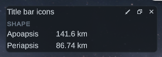

In the modern layout, the title sits on the left and the close button is an X icon. `w.TitleIcon(sprite, tooltip, onClick)`
adds a flat icon before it. The custom info windows use `Sprites.Edit` and `Sprites.Copy` instead of their "E" and "C"
letters (proposal 9A).

### Grouped dropdown

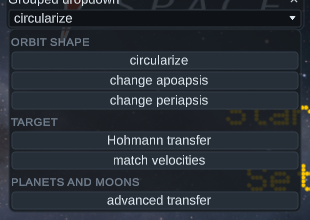

`ComboBox.Group = i => groupName` lists consecutive entries of a group under its header. The Maneuver Planner's 18
operations are sorted into Orbit shape, Target, and Planets and moons. The Node Editor's node and snap selectors, the
Custom Window Editor's window and preset selectors are dropdowns too (proposal 6A, instead of arrow selectors).

## Windows in the modern layout

| Window | Changes |
|---|---|
| Smart A.S.S. | Target tiles with navball markers, the navball cross for orbital targets, a joined mode bar, an AUTO status bar |
| SmartRcs, Translatron | Target tiles or a mode choice, switches, a speed stepper, PANIC as a destructive button, an AUTO status bar |
| Maneuver Node Editor | A node dropdown, steppers in a property grid with one step choice, a snap dropdown, Burn / Time / Display / Execute headers |
| Maneuver Planner | Create / change as one choice, a grouped operation dropdown, an action bar, execute buttons by role, a lead time stepper |
| Utilities, Ascent Settings, PSG Settings | Property grids with switches on the left, titled groups, status bars for warnings |
| Landing Guidance | D-M-S fields with N/S and E/W choices, a nudge pad, the options in a property grid, a status bar while landing |
| Docking Autopilot | The setup problems in one status bar at the top, a property grid, the running state in a status bar |
| Attitude Adjustment | The controller as one choice, switches, the read-outs as an X / Y / Z grid (`VectorGrid`) |
| Flight Recorder | Downrange / Time as one choice, switches, a chip legend in the series colours |
| Delta-V stats | Option chips, the display set as one choice, the current stage highlighted, dim units |
| Menu | The windows grouped by task under six headers |
| Custom info windows | Edit and copy as title-bar icons |
| Custom Window Editor | Window and preset dropdowns |
| Ascent Guidance | Buttons by role, buttons that open the settings windows (selected while open), status bars |
| Rover, Waypoint Help, Rendezvous, Warp Helper | Steppers, switches, the topic choice, buttons by role |

## Rules learned

- A `LayoutElement` with `flexibleWidth = -1` does not stop a layout group's own flexible width: -1 means "no opinion".
  To pin a grid or a segmented bar to its preferred width, set 0 (`FlexibleLayout(0f, 0f)`).
- A `ColorBlock` tint above 1 does not brighten anything. Widgets dim their resting tint (0.8) so that hover can go to white.
- A selectable that switches looks (selected or not) is painted by hand with a colour tint (`Paint`). Swapping sprites
  would leave the previous tint on the renderer.
- `TableLayout` places its rows' cells itself. The rows are `TableRow`s, no-op layout groups, so uGUI's layout passes still
  walk down into the cells, and a change in a cell still walks up to the table.
- Views read the layout settings when they build. A change rebuilds the windows; skins only restyle them.
