# KodeKit layouts and widgets

KodeKit's basic widgets come from IMGUI: rows, panels, scroll lists, labels, buttons, fields. The views build their windows
with them and with the widgets and layouts below. Everything is built in code (no asset bundle), follows the theme, and makes
no garbage per frame once built.

Screenshots come from the gallery test (`MechJeb2_UI/Spike15-Gallery`, run 2026-10-29: KSP 1.12.5, 1920×1080, at MechJeb's
COMPACT spacing, over the main menu). Each widget is shown in its own window. The widget sections show the Flat skin; the
Skins and Segmented sections show all four.

## Settings

The new UI's Settings window has three settings for this. All are saved globally (`MechJebModuleSettings`).

| Setting | Field | Values | Effect |
|---|---|---|---|
| Skin | `UiSkin` | Classic, Flat (default), Glass, ZTheme | The look (see Skins). It applies to every new-UI window at once, without a rebuild. |
| Compact | `UiCompact` | on (default) / off | Tighter margins and rows, in every skin (`Theme.Compact`). MechJeb's IMGUI skin no longer decides this. A custom window's own Compact switch can follow it, or override it on or off. |
| Section headers | `UiSectionHeaders` | on (default) / off | The headers the views add to long windows (`KodeWindow.Header`). Changing it rebuilds the open windows. |

`KodeHost` passes the headers setting to `KodeWindow.ShowHeaders` before it builds the windows. `KodeHost.ThemeFor(skin, compact, opacity)` builds a skin's theme. Tests use the same call.

The choice style is not a setting. Each choice picks its own, by the rule under Segmented. A **Choices** setting was
used to compare the three styles window by window, then dropped (2026-10-30).

## Skins

`Theme.Classic`, `Theme.Flat`, `Theme.Glass` and `Theme.ZTheme` derive from the base theme (KSP's stock sprites,
LiberationSans 13 px, MechJeb's row heights). Each sets the accent colour, the header colour, the hairline (`Rule`) colour,
and the `Primary` / `Danger` / `Selected` button styles. Flat, Glass and ZTheme also replace every sprite with rounded boxes
drawn in code (`Sprites.RoundedBox`, 9-sliced at the corner radius, cached per parameters). The window opacity setting goes
into the window tint's alpha.

**Classic**

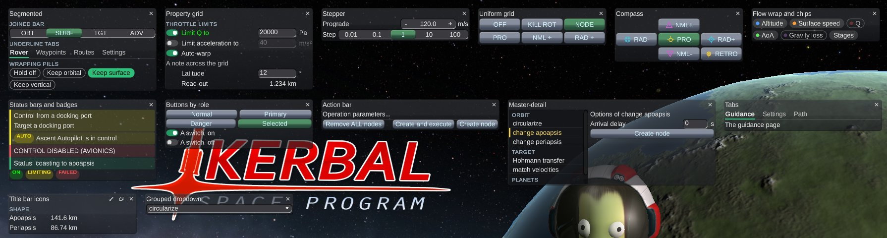

**Flat**

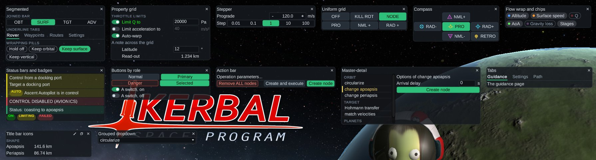

**Glass**

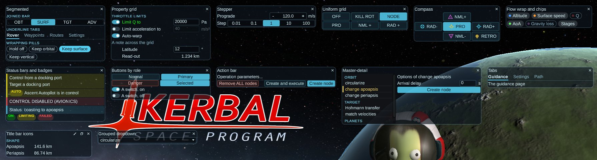

- **Classic**: KSP's sprites, with its own accent colour. Main buttons are tinted blue, destructive ones red, and selected
  choices green, as in IMGUI's selection grids.
- **Flat**: solid dark panels with 4 to 7 px corners and one green accent.
- **Glass**: translucent panels with cyan outlines, close to KSP's navball and map HUD.
- **ZTheme**: purple-tinted dark greys and a green accent, the colours of the ZTheme mod (github.com/zapSNH/ZTheme). It
  doesn't need that mod.

### State looks from rule tables (StyleSheet, StyledPart)

The widgets whose look changes with their state (a chosen segment, a switch that is on, hover and press, disabled, the
keyboard focus) paint from their skin's rule sheet, not from a closure of their own. Each skin is a rule set
(`Headless.Skins`, no Unity type, tested in MechJebLibTest): rules keyed by a part name (`Headless.StyleParts`) and state
flags (`StyleFlags`: Hover, Press, Focus, On, Disabled, Invalid), compiled once into a table of the 64 flag combinations per
part.

- **Parts:** `button.normal|primary|danger|selected` (role buttons and `BindRole`), `switch` and `switch-knob` (Switch,
  Switch3), `segmented`, `segmented-tab` and `segmented-tab-line`, `segmented-pill`, `stepper-field`, `stepper-button`, `chip`,
  `title-icon` and `title-icon.close`, `list-row` and `list-row.header` (ListRow, HeaderButton, the virtual list's and tree's
  rows), `focus-frame` (a field's and a dialog button's keyboard focus). A '.' refines a part (`button.primary` takes
  `button`'s rules first); a '-' names a part of its own.
- **Specificity:** of the rules that match, the deeper part wins, then the rule with more needed flags, then the later one,
  value by value (sprite id, fill, tint, text colour, bold, hidden). The tints follow uGUI's order: disabled over pressed over
  focused (uGUI's selected: a button just clicked shows its normal tint) over hovered.
- **Values:** the fill is the graphic's colour; the tint is the state colour on its canvas renderer, so hover and press
  rebuild no mesh. Sprites are ids (`Headless.SpriteIds`): `Styling.SpriteOf` maps them to the theme's sprites (a role's
  sprite is `Theme.Role(role).Normal`).
- **Palettes:** a skin's rules take the theme's colours (`SkinPalette`: text, dim, accent, the buttons by role), read from
  the live theme by `Styling.PaletteOf`; `SkinPalette.Classic()` and the others are the same values for the tests (Spike 159
  checks they match). Compact shares its skin's sheet: it is a spacing, not a look.
- **`StyledPart`** draws a part on one graphic: the widget sets On (and Focus for a frame) from its model, the pointer sets
  Hover and Press, uGUI's selection Focus, and the Selectable's `interactable` (CanvasGroups included) Disabled, caught by one
  shared check a frame. Every change is an array index into the table, with no allocation; fill, sprite and text are written
  only when they change, so a click's flash isn't cut by a hover. Followers (a switch's knob, a tab's underline) take their
  owner's flags. A part registers with its window in the restyles' order, so a skin switch repaints it after its widget's own
  restyle and before a tone text added later.
- **Still on closures:** the plain skin elements (`ElementStyle`: buttons, toggles, fields, boxes with the skin's sprite swap,
  or `InstantTint` where a skin gives no state sprites), sizes and fonts (layout tokens, not looks), tone texts, badges and
  status bars (their colour is a state the view gives, not a skin's), graphs, the timeline, and the drop-down's highlight
  and the inline edit's look (each a state machine of its own, drawn on pooled rows or a field).

```csharp
// a widget's part: the skin's rules paint it; the widget only says what its model holds
StyledPart part = StyledPart.Add(b.gameObject, Headless.StyleParts.Chip, b.GetComponent<Image>(), b.GetComponent<Button>(), new[] { label });
part.Set(Headless.StyleFlags.On, get());
```

## Layouts

Three uGUI layout groups, in `LayoutGroups.cs`:

| Group | What it does |
|---|---|
| `UniformGridLayout` | Rows of N cells, all the same size: the widest child's width and the tallest child's height. Spare room is shared equally. |
| `FlowLayout` | Children left to right at their preferred size, wrapping to a new line. It asks only for its widest child's width (or `LineWidth`), so it never widens a window to fit everything on one line. |
| `TableLayout` + `TableRow` | Rows of cells in shared columns. Each column is as wide as its widest cell, and `FlexibleColumn` takes the room left over. A row of one cell spans the table. A hidden cell keeps its column. |

They reuse their lists from one layout pass to the next and make no garbage when a window lays itself out again.

### UniformGrid

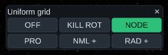

Every cell has the same size, whatever its label. Used by the SmartASS targets (OFF / KILL ROT / NODE, the SURF and TGT
targets), the SmartRcs targets and the joined choice bar.

```csharp
Layout grid = KodeWindow.UniformGrid(parent, columns: 3);
UIButton b = KodeWindow.Button(grid, "PRO", () => ss.target = Target.PROGRADE, true);
w.BindRole(b, () => ss.target == Target.PROGRADE ? ButtonRole.Selected : ButtonRole.Normal);
```

### Compass

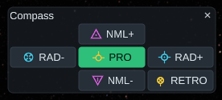

Up to eight cells around a centre, in a 3×3 uniform grid. Used by the SmartASS navball cross (normal up, anti-normal down,
radial in and out at the sides, prograde in the centre, retrograde in a corner, each with its navball marker), and by the
Landing Guidance 10 m nudge pad.

```csharp
KodeWindow.CompassGrid c = KodeWindow.Compass(parent, cell: 20);
KodeWindow.IconButton(c[Dir.N], Sprites.Arrow(Sprites.Direction.Up), () => Move(true, 10));
KodeWindow.Label(c[Dir.C], "10m");
```

`Sprites.NavballMarker(marker)` draws KSP's six orbital markers in white. `Sprites.MarkerColor(marker)` gives each one's
navball colour.

### FlowWrap

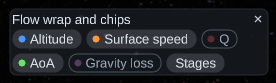

Children wrap to the window's width. Used by the Flight Recorder legend (16 series chips), the Delta-V stats options, and
the pill style of choices.

```csharp
Layout chips = KodeWindow.FlowWrap(parent, spacing: 4);
w.Chip(chips, "Altitude", () => g.displayed[i], v => g.displayed[i] = v, seriesColor);
```

### PropertyGrid

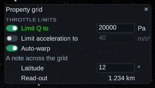

Option rows in shared columns, `[switch] label [field] unit`, so the fields of a block line up. A row whose switch is off
dims its field and unit. Used by Utilities, Ascent Settings (thrust limits, steering, autostage), PSG Settings, Landing
Guidance (autopilot options), Docking Autopilot and the Node Editor (with steppers in the field column).

```csharp
KodeWindow.PropertyGrid g = w.Properties(parent);
g.Switch("#MechJeb_Ascent_checkbox11", () => t.LimitDynamicPressure, v => t.LimitDynamicPressure = v,
    () => t.MaxDynamicPressure.Text, s => t.MaxDynamicPressure.Text = s, 70, "Pa", () => t.MaxDynamicPressure.IsParsed,
    LimiterTones.For(t, LimitMode.DYNAMIC_PRESSURE));  // the label turns green while limiting
g.Field("Min Coast", () => p.MinCoast.Text, s => p.MinCoast.Text = s, 50, "s");
g.Value("Apoapsis", ApoapsisText);
g.Note("Stage fairings when:");                    // one cell across the grid
Layout row = g.Row();                              // any cells, in column order
g.Dim(fieldGo, unitGo, () => !enabled);            // fade cells while a condition holds
g.FlexibleColumn = 0;                              // for label | control | unit rows, without a switch
```

`MuMech.UI.OptionRows` builds the thrust limiter and autostage blocks that several windows share. On MechJeb's editables,
`EditUi.Grid(g, label, () => editable, unit, width)` is the field row (red while the text does not parse).

### MasterDetail

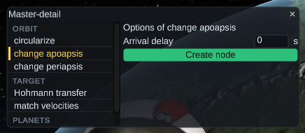

A scroll list on the left, the selected item's details on the right. Consecutive items of the same group are listed under
its header. Meant for the Maneuver Planner's operations, waypoint routes and the Custom Window Editor. The planner uses the
grouped dropdown for now (proposal 6A).

```csharp
Layout detail = w.MasterDetail(parent, listWidth: 160, height: 150, ops.Length, i => ops[i].GetName(), i => GroupName(i),
    () => planner.OperationId, i => planner.OperationId = i);
```

The list is a `Headless.ChoiceModel` with `ItemRole = PartRole.Option` (a list box: nothing chosen is allowed, Up and Down move,
the pattern checks allow at most one option on): a click picks through `choice.Select(i, Pointer)`, and the model's shown entry
marks the row (`ShownChanged`), so a pick, the agent's or a change from outside marks it at once. The overload with
`out Headless.ChoiceModel` hands the model to a test or the agent bridge.

### Tabs

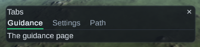

One window, several pages: underlined tabs over one panel per page, with only the selected panel shown. Without get/set,
the window keeps the selection itself.

```csharp
Layout[] pages = w.Tabs(parent, new[] { "Guidance", "Settings", "Path" });
```

The tabs are `Segmented`'s `ChoiceModel` with `ItemRole = PartRole.Tab` (a tab list: exactly one tab on), and the pages follow
its shown entry (`ShownChanged`): a pick shows its page in the same frame, a change from outside at the next sync. The overload
with `out Headless.ChoiceModel` hands out the model.

### Tables (TableModel, TableGrid)

A grid of rows × columns whose behaviour is `Headless.TableModel` (no Unity, tested in MechJebLibTest): Delta-V Stats'
stage stats and PSG Stages' columns. The owner gives the row count and a cell formatter, and optionally the source's version,
the highlighted row, each column's visibility and header by key, row keys and what hiding a column does:

```csharp
var model = new TableModel(() => h.Stages.Count, Format) { Label = "Stage stats", UnitMarkup = "<alpha=#80>" }
    .WithHighlight(CurrentRow)
    .WithColumnState(key => h.IsVisible((StageData)key), key => h.Header((StageData)key))
    .WithHide((key, source) => h.HideColumn((StageData)key));
model.AddColumn((int)StageData.VacDeltaV, h.Header(StageData.VacDeltaV));   // a content column: grows to its widest cell
var grid = new TableGrid(parent, model);
// in the window's refresh
model.Sync();   // pulls the shape, formats the visible cells into their buffers
grid.Draw();    // shows the shape, pushes changed cells, widens columns, paints the highlighted row

void Format(int row, int key, CharBuffer into, ref string unit)   // the value into the cell's buffer; the unit is a constant
{
    double v = h.Value((StageData)key, row, gee, out int decimals, out unit);
    into.Append(v, decimals);
}
```

- **Columns:** a key (the owner's id), a header, a unit, a tooltip, `Visible`, `Hideable`, and a width rule: `Fixed`
  (`Width`) or `Content` (as wide as its header and its widest cell so far, never narrower: it only grows, so changing values
  never lay the table out again; a new header fits it afresh).
- **Shape and values:** `ShapeVersion` changes with the row count, a column shown or hidden, or a header's text; the grid
  then shows or makes cells (a pool that only grows). Without a source version every sync formats the visible cells (live
  values); with one (`WithVersion`), only when it changes.
- **Cells:** each keeps its `Headless.CharBuffer` (CharText's formatting without Unity), so formatting allocates nothing;
  `TableGrid` pushes it with a `CharText` over the same buffer (`new CharText(tmp, buffer)`), only when it changed. A cell is
  its value, then, for a non-empty unit, `UnitMarkup` and the unit.
- **Highlighted row:** the owner's (the stage that burns now), drawn in the theme's accent.
- **Hiding a column:** `TableGrid`'s header buttons call `model.Hide(column, Pointer)`, which asks the owner (`WithHide`); a
  column that isn't `Hideable` (the stage column) refuses.
- **Selection** (no modifier key): `model.Selection` toggles rows (kept by row key, `WithRowKeys`: a row that goes leaves it),
  selects a range of rows in the table's order or a cell range (anchor and focus cell). No table draws it (Delta-V Stats has
  no row check boxes, the user's call): a host or an agent sets it, and the copies honour it.
- **Copies:** `model.CopyText(sb, headers)` writes the selected cells as shown, tab and newline separated; `model.CopyRows(sb)`
  the same, or every row when nothing is selected (the Copy button, which copies every row); `model.CopyMarkdown(sb)` those rows as a GitHub Markdown
  table (`Headless.MarkdownTable`: the headers, an alignment row with every column right-aligned `---:`, `|` written `\|`, a
  line break a space, units kept). A column with `Copied = false` (PSG Stages' buttons) and a hidden column are left out,
  and the rows are written in the model's order. `StageStatsTable.CopyButtons(parent,
  () => model)` adds Copy and Copy table as Markdown (two buttons rather than a format choice: each is one click and neither
  hides a state that changes the other), each with a toast of the row count. The rule: a copy writes what the table draws, so
  a host whose lines are not its data's rows makes the model's rows its drawn lines (PSG Stages).
- **Sorting:** none; no table sorts today.
- **Finding a grid:** `window.Root.GetComponentInChildren<TableGridHandle>().Grid` (a test, the agent bridge).

PSG Stages draws its own rows (stage rows with check boxes and buttons, a coast row, skipped stages): its headers, widths,
tooltips and the Spin column's visibility come from a `TableModel` with fixed columns, and its stage cells (name, Δv, time,
TWR) are that model's formatted cells. The model's rows are the table's lines top-down as drawn (`PsgTableRows.TopDown`, tested
in MechJebLibTest): the stage rows, the coast as its own line above its burn (after, during) or below it (before), a dedicated
coast in place of its engine-less row, and no other engine-less row. Guided, Full and Spin are formatted "yes"/"no" for the
copies (the table draws switches), and its Copy and Copy table as Markdown buttons write every line (it draws no row check
boxes).

### Several rows selected (SelectionSet, SelectionColumn)

`KodeKit/Headless/SelectionSet.cs` is a multi-selection of a list's rows without Unity (`SelectionSetTests`), drawn by
`KodeKit/SelectionColumn.cs` as a toggle column: a check box at the start of each row of a `VirtualList` of `ListRow`s.

```csharp
var selection = new SelectionSet<ItemKey>(() => items.Count, i => KeyOf(i));   // kept on the module: the host builds a new view on a rebuild
SelectionColumn.Add(w, list, selection, "#MechJeb_NewUI_SelectItem",            // a box per row, rows made later too,
    i => items[i].Name, "#MechJeb_NewUI_SelectRow");                           // each named after its row: "Select Apoapsis"
SelectionColumn.AllBox(w, row, selection, "#MechJeb_NewUI_SelectAll");          // every shown row, or none
// a button acting on the checked rows, as one commit of the list
target.Apply(direction, d => selection.MoveSelected(d, module.MoveItem), KodeWindow.Pointer);
target.Apply(n, _ => selection.RemoveSelected(module.RemoveItem, source), source);
```

- **Names:** each box is named after the row it is bound to (`rowName` through `rowFormat`), so an agent and the pattern
  checks tell the boxes apart (review 4 R4-2); nothing is drawn for it. The name is made again only when the box's row
  changes, the list's data does (`VirtualList.BindVersion`: a reorder, a remove, a rename rebind rows that keep their index)
  or a language switch relabelled it: no garbage on a frame with no change.
- **Keys, not indexes:** a row keeps its check when rows above it come, go or move, on a rebind, a scroll of the virtual list and a
  rebuilt view; `Prune()` drops the keys of rows that are gone (the host calls it when its rows change). A list that can hold the
  same item twice keys a row by the item and its place among the equal rows (the window editor's `ItemKey`); `RemoveSelected`
  drops each key as it removes its row, so a check never passes to the other copy.
- **No key, no modifier:** a click toggles a box (`Toggle`, `Set`); there is no Shift range or Ctrl toggle, since Left Shift and
  Left Ctrl are KSP's throttle keys, live over a window (Spike 167 holds them over a click: the throttle moves, the selection
  takes one row). `SelectRange` exists for a host or an agent.
- **A filter** (`ShowOnly(i => shown)`) hides rows without unchecking them; `SelectAll`, `SelectRange` and the actions take only
  shown rows, so a hidden row is never removed or moved unseen (`HiddenCount` counts them).
- **Actions:** `SelectedIndexes` (list order, not click order); `MoveSelected(±1, move)` moves the checked rows one place as blocks
  (a block at the end, or behind a checked row that stays, stays); `RemoveSelected(removeAt, source)` from the last row up. The
  host wraps each call in one commit of its list, so its undo stack takes the whole action back.
- **The box** is `w.SelectBox(parent, get, set, name, text)`: a check box that ticks at once (no fade) and whose commits are view state (no settings save, no
  undo entry), in a row that doesn't stretch, with no label unless given one; `VirtualList.ListRows` measures a row's wrapped
  text beside it.
- **Uses:** the custom window editor's contents list: a box per row and an All box over it; with rows checked, Remove, Move up and
  Move down act on them and say how many ("Remove (3)"), each one commit of the item list (its undo puts the items back);
  with none checked they act on the selected row as before. The checks live on the editor module (`itemChecks`: the host builds a new view on a rebuild), kept across rebuilds of the same window and emptied
  when another window is edited.
- **Per frame:** each box pulls its state once a frame (`IsSelected`: the row's key and a look-up in the few checked keys), no
  garbage; with nothing checked it returns at once.


### ActionBar

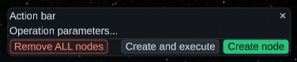

The bottom of a window, under a hairline: destructive actions on the left, the others on the right, the primary action
last. Used by the Maneuver Planner.

```csharp
KodeWindow.ActionBarRow bar = KodeWindow.ActionBar(parent);
bar.Danger("#MechJeb_Maneu_button3", RemoveAllNodes);
bar.Normal("#MechJeb_Maneu_button2", () => CreateNodes(true));
bar.Primary("#MechJeb_Maneu_button1", () => CreateNodes(false));
```

## Widgets

### Segmented (one choice out of several)

Each window shows the three styles, top to bottom: joined bar, underline tabs, wrapping pills.

| Classic | Flat | Glass |
|---|---|---|
| 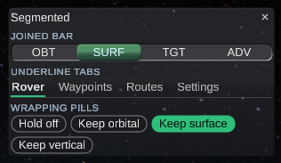 | 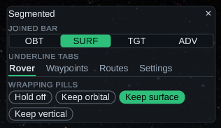 | 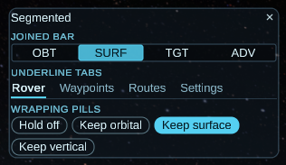 |

One control for "exactly one of these". It replaces SelectionGrid rows and sets of checkboxes that act as one choice.

**Which style:**

- **Tabs for navigation.** A navigation choice only changes what the window shows; picking one does nothing to the
  vessel or the settings.
- **Joined for the rest:** modes, settings and values.
- **Pills** stay in KodeKit but no MechJeb window uses them.

```csharp
w.Segmented(parent, modeKeys, () => (int)ss.mode, i => ss.mode = (Mode)i, ChoiceStyle.Tabs);   // navigation
w.Segmented(parent, labels, get, set);                                                          // Joined, the default
```

In the windows (Flat; Spike 9 run modern3):

| SmartASS: mode as tabs | Waypoint Help: topics as tabs | Translatron: mode as a joined bar |
|---|---|---|
| 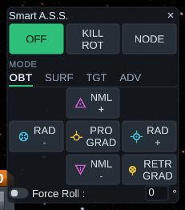 | 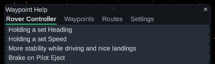 | 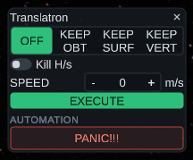 |

| Tabs (navigation) | Joined |
|---|---|
| SmartASS mode (OBT, SURF, TGT, ADV: it only switches which targets are shown), Waypoint Help topics, `Tabs()` pages | Translatron modes, attitude controller, Node Editor conics mode and step, Flight Recorder Downrange / Time, Maneuver Planner create / change, PSG coast location, Landing N/S and E/W, Delta-V display set (a saved column preset) |

The behaviour is `Headless.ChoiceModel` (tested in MechJebLibTest): what is selected, what a click or a key does, and
`ShownChanged`, which fires whenever the shown entry changes, by a pick or by the once-a-frame `Sync`. The bar repaints
on that event, so a click shows at once; a pick syncs the model itself, so `Sync` alone would never see it.

### Switch and SwitchRow

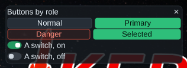

An on/off switch: a pill track in the accent colour, with a knob that moves. `SwitchRow` puts the switch on the **left**
of its label (proposal 4A, switch on the left), and a click on the label flips it too.

```csharp
w.SwitchRow(parent, "#MechJeb_NodeEd_checkbox1", () => core.Node.Autowarp, v => core.Node.Autowarp = v);
```

Its behaviour is a `Headless.ToggleModel` (see "Input widgets on models" below), as is the `CheckBox`'s.

### Switch3 (three positions)

A switch with a knob at the left, middle or right, for a setting that can follow something else: off, follow, on. The position's
name sits beside it, and a click on a third of the track moves the knob there. The right position takes the accent colour.

```csharp
w.Switch3(row, names, () => (int)edited.Compact, v => edited.Compact = (MechJebModuleCustomInfoWindow.CompactMode)v);
```

Its behaviour is a `Headless.Switch3Model`: a click on the knob's own third calls nothing.

### Stepper

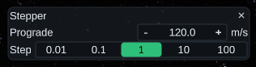

A value and its nudges as one control: `[−][value][+]`. − and + add ∓step(), ×10 with Right Shift or Left Alt held. With `repeat`, they
repeat while held. The step is a separate choice, made once (a "Step" segmented row) instead of a step field on every
axis. The buttons are at least a row high and wide: IMGUI's 15 px buttons are too small to hit.

Left Shift gives no ×10 on − and +: it is KSP's throttle up, and a pointer over a window leaves flight keys live
(`HoverLock` keeps the keyboard), so holding it for a ×10 would raise the throttle too (Spike 143). In the focused field,
Up/Down are ×10 with either Shift or Alt, since the field's lock keeps the keyboard from KSP; PageUp/PageDown are ×10
always. Either Alt gives ×10, but the texts name Left Alt: on Windows, AltGr (the right Alt of AZERTY and QWERTZ layouts)
also sends Left Ctrl, KSP's throttle down, so it lowers the throttle over a window. `Headless.StepperModel` holds that rule (`BigOnButton`, `BigOnKey`, `Press`, `Key` with `StepperModifiers`): the
widget reports the modifiers held and the model decides.

```csharp
w.Stepper(row, () => ed.prograde.Text, s => ed.prograde.Text = s, d => { ed.prograde = ed.prograde + d; ed.UpdateNodeFromFields(); },
    () => ed.progradeDelta, 70, () => ed.prograde.IsParsed, repeat: true);
```

Where: Node Editor axes and time shift, Rover heading and speed, Translatron speed, planner lead time. Its field is
`FieldKind.Centred`: the value sits in the middle, between - and +, and in the middle of the box's height.

### Filter and type-to-jump (FuzzyFilter, TypeaheadModel)

Two Unity-free models in `KodeKit/Headless/` for long lists, tested in MechJebLibTest:

- **`FuzzyMatcher` / `FuzzyFilter`**: type letters, keep the items that hold them in order (ignoring case and the query's spaces),
  best first. Bonuses for a prefix, a word start (after a space or symbol, or at a lower-to-upper case change as in
  `TimeToApoapsis`) and consecutive letters; a gap costs. Each item has a label (the localized text shown) and a key (its
  English name, from the info item's token), and matches by either. The order is stable: score, then the shorter text, then the
  item's own position. An empty query lists every item in its own order. `Apply(query)` allocates nothing; `Highlight` gives the
  matched ranges of a label.
- **`TypeaheadModel`**: `Type(char, now, count, label, current, key)` returns the index to focus: the first entry starting with
  what was typed, a repeated letter stepping through those with that letter, a pause longer than `Timeout` starting over. The time
  is the caller's. The drop-down draws it (`ComboModel`, below).

The first use is the Custom Window Editor's item list: a filter field above it, over a virtual list (below) whose rows are the
filter's results by rank. A keystroke calls `FuzzyFilter.Apply`, sets the list's count to the results', scrolls it to the top and
binds the rows in view again; no row is made. The field is `EditFields.Field` like any other. An item's English key is
`FuzzyKeys.FromToken(item.name)` (`#MechJeb_Altitude_ASL` gives `Altitude_ASL`).

```csharp
registryFilter = new FuzzyFilter(labels, englishKeys);
registryList = VirtualList.ListRows(w, r, 160, registryFilter.Results.Count,
    rank => items[registryFilter.Results[rank].Index].localizedDescription, rank => ed.AddItem(items[registryFilter.Results[rank].Index]));
EditFields.Field(w, row, () => text, s =>
{
    text = s;
    if (!registryFilter.Apply(text)) return;
    registryList.SetCount(registryFilter.Results.Count);
    registryList.ScrollTo(0, ScrollAlign.Start);
    registryList.Rebind();
}, 150);
```

### VirtualList (long lists build only their visible rows)

`VirtualListModel` (`KodeKit/Headless/`, tested in MechJebLibTest) holds a list's geometry without Unity: the count, one row
height (or, after `SetRowHeights(i => h)`, each row's own, asked again only when the count changes or on `RefreshHeights`), the
spacing, the viewport's height and the scroll offset. From them it gives the visible rows, the rendered ones (the
visible plus `Overscan`, 2, on each side), the content's height, `IndexAt(y)`, `RowTop(i)` and `PoolSize`, the rows enough for
any offset (those that fit, one more, and the overscan). `ScrollTo(index, Start | Center | End | Nearest)` clamps to the list. One
row can be taller (`SetExpanded(index, extra)`): an editor under the selected row. A change of the count, a height, the spacing,
the viewport or the expanded row keeps the first visible row where it was in the view; `Inserted`/`Removed` move that anchor with
its row.

`VirtualList<TRow>` (`KodeKit/VirtualList.cs`) draws it: a scroll list that looks like `KodeWindow.ScrollList` (same backdrop,
scrollbar, wheel speed, height), whose content has no layout group. It makes `PoolSize` rows with the host's `create`, places
each by hand at `RowTop(i)` (anchored to the content's top, full width, `HeightOf(i)` high) and calls the host's `bind(row, i)`
when a scroll brings index `i` into that row (row `i` lives in slot `i % PoolSize`, so no two rendered rows share one).

- Each row is a layout root: its own text change relayouts that row only (rule 1), and nothing in the list relayouts the window.
- The row height is the preferred height of a row bound to index 0, measured once the list has a width (its window's first
  layout, in the build's own frame) and again after a restyle or a width change; the UI scale only scales the canvas. With
  `SetRowHeights((i, width) => h)` each row gets its own height at that width instead.
- A row's index changes as it scrolls: a click handler asks `list.IndexOf(row)`, never captures an index.
- A host with live rows (the waypoints' distances) writes only `RenderFirst..RenderLast`, through `list.RowAt(i)`.
- `VirtualList.ListRows(w, parent, height, count, text, click)` is the common case: `KodeWindow.ListRow`s whose text wraps as
  in a `ScrollList`, each row as high as its text at the list's width (`TextMeasure` once per text, cached until a restyle or a
  width change): a long label takes two lines, a label with a fallback-font glyph (Δ) its taller line, as before.
  `EmptyLabel("#key")` shows a note while the list is empty.
- `SetCount`, `Rebind` (same count, other data), `ScrollTo`, `SetOffset` and `SetExpanded` are public, for the program, keys
  and the agent bridge.

Where: the Custom Window Editor's item list (63 rows for the Vessel category: about 13 built), the Waypoints window's list (any
number of waypoints: about 14 rows built and written each frame; the selected waypoint's edit panel is the expanded row's
extra height, placed under its button).

```csharp
wpList = new VirtualList<WpRow>(w, page, 300, 0, CreateRow, row => row.Item.rectTransform, BindRow, 2);
// per frame: wpList.SetCount(n); for (int i = wpList.Model.RenderFirst; i <= wpList.Model.RenderLast; i++) Fill(wpList.RowAt(i), i);
```

### Toasts

Short notices in a corner of the windows' canvas (bottom right): `Toasts.Show("#key or text", ToastSeverity.Success)`, from any
UI code on the main thread. For feedback that a click leaves nowhere else to show: a copy done, a window deleted, defaults
restored. Their behaviour is in `Headless/ToastQueue.cs` (tested in `ToastQueueTests`); `KodeKit/Toasts.cs` draws it:
- at most four are visible, the rest wait in order; the same text and severity shown again is counted (a "×3" badge), not
  stacked, and gets its full time again;
- each severity has its own duration (`Toasts.Queue.SetDuration`; 0 keeps the toast until a click), and the time starts when
  the toast becomes visible;
- the pointer over any toast stops all timers; a click dismisses the toast, and the host counts the pointer over a toast as
  over a window (`Toasts.PointerOver`), so MechJeb's click-through lock keeps that click from the part or map under it;
- the stack's update runs only while a toast is on screen or waiting; a scene change dismisses every toast; the toasts draw
  under a dialog (Overlays, below);
- the colour strip is the theme's Good, Warn and Bad (Info: Dim), the panel is the theme's Tooltip look, and the
  stack follows the canvas scale;
- each toast is logged (`[MechJeb2.UI] toast (Success): ...`), and `Toasts.Queue.Posted` / `Closed` are there for the agent
  bridge.

The rows are made once and reused: a frame with no change allocates nothing. KSP's `ScreenMessages` are not replaced by this:
the in-flight notices keep using them.

### Drag to reorder and transfer (ReorderModel, TransferModel, AutoScrollModel, ListDrag)

Three Unity-free models in `KodeKit/Headless/`, tested in MechJebLibTest, work on a `VirtualListModel`'s geometry:

- `ListDrop.GapAt(list, y)`: the gap under the pointer, 0 (above the first row) to `Count` (below the last); a row's upper half is
  the gap above it, its lower half (and the spacing under it) the gap below. `ListDrop.IndicatorY(list, gap)` places the line.
- `ReorderModel(() => count, (from, to) => move)`: `Begin(row)`, `Over(gap)` / `OverAt(list, y)` / `Outside()`, then `Drop()` or
  `Cancel()`. Nothing moves before the drop; the two gaps around the dragged row are no move (no indicator); a release outside
  the list drops nothing. `IsFixed(i)` marks rows that can't be dragged and keep their index (the gap stops beside them).
  `Move(from, to, source)` and `MoveBy(row, ±1, source)` are the same move without a drag: the Move up/down buttons and the
  agent bridge call them.
- `TransferModel(() => sourceCount, () => targetCount, (row, at) => insert, mode, row => remove)`: a drag from one list into
  another, `Allow(row)` refusing rows, `Copy` (the source keeps the row) or `Move` (insert, then remove from the source).
  `Transfer(row, at, source)` is the same without a drag (a click adds at the end).
- `AutoScrollModel`: the pointer within `Edge` (24) of the viewport's top or bottom, or past it, scrolls at 60 to 600 units a
  second (with the square of the depth into the zone), after `Delay` (0.15 s) in the zone, each step capped at `MaxStep` (0.1 s).

`ListDrag.ForReorder(w, list, reorder, i => label)` and `ListDrag.ForTransfer(w, source, target, transfer, i => label)`
(`KodeKit/ListDrag.cs`) draw them on `VirtualList`s (any row type, through `IVirtualList`): a drag handler on each row of the
source (rows made later get one too, `RowCreated`), an accent line in the target's content at the gap, a label of the dragged
row by the pointer, and auto-scroll while the pointer is over the target's column near or past (40 units) its ends.

- A row is the nearest `IDragHandler` under the pointer (FINDINGS: a drag goes to the nearest handler up from the hit), so a drag
  from a row moves neither the window nor the list (the source list included: a drag on it no longer scrolls it); the wheel
  and the scrollbar still scroll it. Only the left button drags, and a drag isn't a click (`eligibleForClick` is cleared when
  it starts).
- Once it starts, the drag's `pointerDrag` is an empty object of the list (`ListDragCatcher`), so a row recycled out of the
  pool mid-drag doesn't lose its events. Only the end event drops; a drag uGUI lets go of without one, the game losing the
  focus, or the list changing under the drag (the host calls `Cancel`) ends it without a drop.
- The pointer is read every frame (uGUI sends `OnDrag` only on movement), so the indicator follows an auto-scroll.
- No keys: Alt is KSP's `MODIFIER_KEY`, the arrows turn the camera, and a list row has no keyboard lock (rule 54), so keyboard
  moves are left to the bridge's calls on the models. Escape is KSP's pause key: a release outside the list cancels.
- A host applies a drop in one call (its `move`/`insert`), then tells the list: `list.Removed(from, 1); list.Inserted(to, 1)` or
  `list.Inserted(at, 1)`, which keep the view where it was and bind the rows again.

Where: the Custom Window Editor. The window's items are a `VirtualList` with drag to reorder (the Move up/Move down buttons
stay, through `ReorderModel.MoveBy`), and the registry's rows drag into it (a copy; a click still adds at the end). Each drop is
one call of `MechJebModuleCustomWindowEditor.MoveItem` or `AddItem(item, at)`, the step an undo stack takes back.

```csharp
reorder = new ReorderModel(() => edited.items.Count, (from, to) => { ed.MoveItem(from, to); list.Removed(from, 1); list.Inserted(to, 1); });
ListDrag.ForReorder(w, list, reorder, i => edited.items[i].ListName);
```

### Trees (TreeCollection, TreeReorder, TreeList)

`TreeCollection<T>` (`KodeKit/Headless/TreeCollection.cs`, Unity-free, tested in MechJebLibTest) holds nodes with a key, a label,
an optional search key (an English name) and a value, added parent first (`Add`, `AddBranch` for a branch that may stay empty).
Its state (open branches, checks, the branches open before a search) is kept by key in a `TreeState`, so a tree built again with
the same keys and state (a view rebuilt) keeps it.

- `VisibleRows`: the roots and, under each open branch, its children, depth first; each `TreeRow` has its node, depth, whether it
  can fold (`Expandable`: a branch with a visible child) and whether it is open. A closed ancestor hides its descendants. Its
  count is the virtual list's count; it is rebuilt only after a change (`Version`).
- `Open`, `Close`, `Toggle` (one branch), `OpenAll`, `CloseAll`, `Reveal(key)` (its ancestors).
- `Find(query)`: the leaves are matched (label, then search key, with `FuzzyMatcher`); only matching leaves stay visible, every
  branch with a match opens and every other branch closes (still listed, nothing to open). `Find("")` ends the search: every
  leaf back, the branches open before it open again. `MatchCount` per node after `UpdateCounts`.
- `Check(key, on)` sets a node and its descendants; `StateOf(key)` is `All`, `Some` or `None` for a branch from its leaves.
- `MoveChild(parent, from, to)` reorders siblings (a branch with its subtree). `TreeReorder<T>` wraps a `ReorderModel` over the
  visible rows that moves a row among its siblings only (the rows of other parents are fixed rows; no reorder during a search):
  hand its `Model` to `ListDrag.ForReorder`. Nothing in MechJeb uses it yet.

`new TreeList<T>(w, parent, height, tree, row => text, (node, row) => leafClick)` (`KodeKit/TreeList.cs`) draws the visible rows
on a `VirtualList<UIButton>` of ListRows (`List`): each indented by its depth, a branch with a fold chevron (down: open, right:
closed) and its label in the header colour, a leaf lined up with its parent's text. A click on a branch folds it (`Fold(row)`:
the rows under it inserted or removed below it, the rows in view stay put); a click on a leaf calls `leafClick`. `Find(query)`
or the model's `Find` then `Refresh(true)` shows a search from the top; while a search matches nothing the list has no row
(its `EmptyLabel` shows). The list follows the model's `Version` once a frame, so an agent's `Toggle` shows. No keys fold or
move rows (Left, Right, Up, Down and `*` are KSP's flight and camera keys; rule 54). Rows are measured at the width their
indent leaves.

KodeUI's `TreeView` (in `MechJeb2.UI/KodeUI/`, a copy of KodeUI's sources) stays unused: it builds a row per item, takes its
look from KodeUI skin styles KodeKit's themes don't set, and KodeUI compiles alone (it can't use `KodeKit.Headless`).

Where: the Custom Window Editor's registry. Its category drop-down has "All" first: every info item as a tree by category
(`MechJebModuleCustomWindowEditor.itemCategoryAll`, saved; the open branches in `itemTreeState`, kept across the view's
rebuilds); a branch's label holds its item count (its matches during a search). The filter field searches the tree. A click on
an item adds it at the end and a drag transfers it into the window's list (`TransferModel.Allow` refuses branch rows). The
other categories are the flat filtered list as before.

```csharp
var tree = new TreeCollection<InfoItem>(state);
tree.AddBranch("category:Orbit", "Orbit");
tree.Add(item.id, item.localizedDescription, item, "category:Orbit", FuzzyKeys.FromToken(item.name));
var view = new TreeList<InfoItem>(w, r, 160, tree, row => row.Node.Label, (node, row) => transfer.Transfer(row, count, ChangeSource.Pointer));
filterChanged = q => view.Find(q);
```

### Chip

An on/off pill with an optional colour dot: filled when on, outlined and dim when off. Used by the Flight Recorder legend
and the Delta-V stats options. Shown in the Flow wrap screenshot.

### Badge and StatusBar

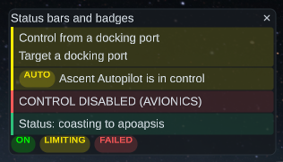

A badge is a small upper-case pill of text in a tone's colour. A status bar is a strip across the window, with a coloured
edge, a tint of the same colour, and any rows inside it. The tone is read every frame.

- **At the bottom**, it says who is in control. SmartASS, SmartRcs and Translatron keep their body in view, greyed and
  inert, with an "AUTO" badge and the controlling module's name (`GuidanceUi.AutoBar`). Also used for the landing,
  docking, ascent and autostage status.
- **At the top**, it lists what is wrong. The Docking Autopilot's three setup problems go in one bar at the top, where
  IMGUI showed them.
- Warnings: PSG Qα limit, planner operation errors, differential throttle, "CONTROL DISABLED".

```csharp
Layout bar = w.StatusBar(parent, () => KodeWindow.Tone.Warn);
w.Visible(GuidanceUi.Wrapped(bar, "#MechJeb_Docking_label2").gameObject, () => noDockingPortControl);
```

### Meter (a value on a scale: GaugeModel)

A value against a scale and optional low, high and optimum points, drawn as a filled bar: ui-sdk's `gauge`, with HTML's
`meter` rules in a Unity-free `Headless.GaugeModel`. `w.Meter(parent, label, model, template)` draws label, bar and value.

- **The model** reads the value and each bound through a delegate at each `Sync` (a setting moves them): min 0 and max 1
  without one; a scale that isn't finite or whose max isn't above its min has no scale; a value that isn't finite draws empty
  and the text says "n/a" (`Available` false). A value off the scale is clamped for the bar and kept in the text. A missing low
  or high bound is the min or the max (no mark drawn); a low bound above the high bound degrades to a plain bar (no zones). The
  zone is Low under the low bound, High over the high bound, Mid between (bounds included). The optimum rates the zones as HTML
  does: inside the bounds, Mid is good and the ends fair; under the low bound, Low good, Mid fair, High poor; over the high
  bound, the reverse; no optimum, no rating (plain).
- **The bar:** the fill's colour is the rating's (good, warn, bad; a plain bar the accent), marks at the bounds given, and the
  value as text in the model's `Format` (MechJeb's formatters on a `CharBuffer`). A fair or poor value also says its zone in
  words ("95 % high"), so colour is never the only sign. The tooltip is the model's sentence (`Describe`).
- **Per frame:** a hidden meter isn't read at all (one `activeInHierarchy` check); a shown one calls `model.Sync()` and writes
  the fill, the marks and the text (`CharText`, no string) only when they changed: no garbage. The meter owns the model's
  `Sync`; the bridge and tests read the model as drawn.
- **The words** (`KodeWindow.MeterWords`) are the `#MechJeb_NewUI_Meter_*` keys, read raw (their `<<1>>` kept) and again after
  a language switch; `Headless.GaugeWords.Fill` puts the numbers in.
- **The bridge** lists a shown meter as kind `meter` (ref `w3.m<n>`): its label, its sentence as the value ("Throttle: 95 % on
  0 % to 100 %, low under 40 %, high over 80 %: high, fair"), the scale as `range`, `invalid` with no value, and no action.
- **In MechJeb:** Utilities' throttle and acceleration, under the throttle limits, only with Settings > Windows > "Show throttle
  and acceleration meters" on (off by default: no window changes for a player who doesn't turn it on). They only draw: nothing
  feeds back into the limiter.

```csharp
var throttle = new Headless.GaugeModel(() => vessel.ctrlState.mainThrottle, null, null, MinThrottle, MaxThrottle, Optimum,
    (b, v) => b.Append(v * 100, 0).Append(" %"));
w.Meter(box, "#MechJeb_NewUI_MeterThrottle", throttle, "100 % high");
```

### Buttons by role

`ButtonRole.Normal`, `Primary` (the main action), `Danger` (destructive) and `Selected` (a chosen option). Each role has
its own style in Flat, Glass and ZTheme. Classic tints the stock button for each role. Use `w.BindRole(button, () => role)`
for a role that follows a state, such as a state button that turns Selected while its mode is on.

A fixed role is `Button(..., role)` or `KodeWindow.Role(button, role)`.

```csharp
KodeWindow.Button(parent, "#MechJeb_NodeEd_button6", () => core.Node.Abort(), ButtonRole.Danger, true);
```

### Text colours (tones)

`KodeWindow.Tone` is Normal, Good (green), Warn (yellow), Bad (red), Dim or Caution (orange, MechJeb's `OrangeLabel`); `Theme.ToneColor(tone, normal)` gives its
colour in a theme, with the plain text, a button's text or the accent colour for Normal. All in the window's own theme.

```csharp
w.ToneText(label, () => engaged ? Tone.Good : Tone.Normal);        // follows a state, set when it changes
w.ToneText(buttonLabel, () => tone(), true);                        // Normal is the button's text colour
KodeWindow.ToneText(note, Tone.Dim);                                // fixed: restyled with the theme, no binding
w.Toggle(parent, "#key", get, set, () => tone());                   // a toggle whose label follows a state
```

### Live text and visibility

`w.BoundLabel(parent, template, () => text)` is a label that changes, in a cell sized from the template, so the text
never moves the layout. `w.Visible(label, ...)` and `w.Visible(toggle, ...)` show or hide a live label's cell or a toggle's
whole row (`KodeWindow.CellOf`, `KodeWindow.RowOf`).

A live text with no fixed length (an autopilot's status) ends in an ellipsis when it is wider than its cell. IMGUI wraps
it: `w.Wrap(w.BoundLabel(parent, () => status, true))` wraps it too, and the cell grows to the lines it needs. The text
is measured only when it or the cell's width changes, and the layout moves only when the line count does.

### Header and Rule

`KodeWindow.Header(parent, text)` is a small, upper-case, bold header in the theme's header colour. A trailing colon is
dropped ("Mode:" becomes "MODE"). Headers are hidden when the **Section headers** setting is off, unless `always`.
`KodeWindow.Rule(parent)` is a hairline in the theme's rule colour.

### Title bar icons

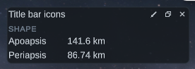

The title sits on the left and the close button is an X icon. `w.TitleIcon(sprite, tooltip, onClick)`
adds a flat icon before it. The custom info windows use `Sprites.Edit` and `Sprites.Copy` instead of their "E" and "C"
letters (proposal 9A). Each icon with a tooltip is also an entry of the title's context menu (a right-click on the title), named by
its tooltip, with Close last (Context menus, below).

### Graphs: pan and zoom (`LineGraph.View`)

A `LineGraph`'s X axis is a `KodeKit.Headless.ViewportModel` (`graph.View`): the window of the data the plot shows, with
no Unity type, tested in MechJebLibTest (`ViewportModelTests`). One model is one axis; the graphs zoom X only, since each
of their series has its own Y range and unit.

- The host gives it the data's range, `View.SetData(min, max)`, and the span its own scale controls pick,
  `View.SetDefaultSpan(span)` (the Flight Recorder: the plot's width times its scale per pixel; the PSG Solution window:
  the plan over 2^Zoom). Until the user zooms, the span follows that default.
- Over the plot, the wheel zooms about the pointer (1.25 a notch), a left drag pans (the value grabbed stays under the
  pointer, and the drag no longer moves the window), a double-click resets to the default span. `ViewportInput`, an
  invisible raycast area under the series, takes these events.
- The scrollbar and the follow toggle under the plot are views of the same model (`ScrollValue`, `ScrollSize`, `Follow`).
- Refresh the graph when `graph.ViewMoved` (a pan, zoom or reset: `View.MoveVersion`): after such a move every series mesh
  is rebuilt in the next frame; when only the data grew (`View.Version`), one a frame as before. `Follow` alone bumps neither.
- Series added with `AddSeries` are read through a `WindowedSource`, which adds a point interpolated on each edge of the
  window, so a zoomed line reaches the plot's edges.
- A view that is rebuilt (a new plot height, a skin, a language) keeps the zoom by passing the same model to the new
  `LineGraph` (`new LineGraph(..., view)`; the two windows keep theirs per module).
- Keys: the model has `Key(ViewportKey)` (pan, zoom, Home/End, reset) for the agent bridge and tests, but no key is routed
  from the game: a window has no keyboard focus in flight, and every key a graph would use is a flight or camera key
  (arrows, keypad +/-, Home/End are bound).
- `ToFraction`/`FromFraction` map data to the plot's 0..1, and `Show(from, to)` zooms to a range (a burn): the range picker
  and the timeline below use them.

### Graphs: a range and points (`LineGraph.Ranges`)

`graph.EnableRanges(model)` adds a range selection and marked points on the X axis: a `KodeKit.Headless.RangeModel` on the
graph's `View`, with no Unity type, tested in MechJebLibTest (`RangeModelTests`). Its rules are in its summary: start ≤ end,
a minimum width (the viewport's `MinSpan` by default, so a range can always be zoomed to), clamped to the data, ends that
stop short of each other, a move that keeps the width, points (at most 8, the oldest dropped) with an active one, the
nearest point within a pick distance. A host keeps the model across rebuilds as it keeps the view.

- Over the plot (`ViewportInput`): a **right drag** draws a range, or moves it when it starts inside it, or moves an end
  when it starts on one; a **left drag** on an end or a point moves it, and pans anywhere else (the viewport's drag);
  a **right click** marks a point, or removes the one under it; the double-click still resets the view. The ends and points
  are grabbed within `RangeOverlay.PickPixels` (6 px).
- Why the right button: the left drag pans and the double-click resets (the viewport), and Shift, Ctrl and Alt are flight keys
  (throttle, the modifier); a mode toggle would be a state to remember and a control to place. KSP orbits its camera on a
  right drag even over a window (the hover lock leaves the cameras alone), so `ViewportInput` locks `CAMERACONTROLS` while
  the right button is held on the plot. The lock and a right-button drag also end in the first frame the button is found up, or when the
  game loses focus: a release outside the game (Alt-Tab mid-drag) sends uGUI no pointer-up.
- `RangeOverlay` draws the band (under the series), its two ends and a line per point (the active one brighter), placed by
  anchors from the view each frame they change (no allocation otherwise); a pan or zoom moves them with the data.
- `RangeModel.ZoomToRange` calls `View.Show(start, end)`.
- `SampleStats.ValueAt` and `SampleStats.Over` read a series' value at a point and its ends, change, min and max over a
  range (`ISamples`: the same members as `IGraphSource`), interpolated linearly, without allocation.
- The Flight Recorder shows, under the plot, the range's ends and width (Zoom to range, Clear), the active point's time
  (Clear points), and a table of the displayed graphs: the value at the point, and the change, minimum and maximum over the
  range, in each graph's unit. A hint replaces them while nothing is picked. A Mark or a switch between Time and Downrange
  clears them. The table is recomputed when something changes; during a drag, when one readout costs more than 0.5 ms (a long
  history, many graphs), ten times a second. The PSG Solution window doesn't enable ranges yet.

### Graphs: the values under the pointer (`LineGraph.Readout`)

`graph.EnableReadout()` adds a hover read-out: while the pointer rests or moves over the plot with no button held, a thin
vertical cursor line at it and, beside the pointer, the hover card with the X there (as the axis gives it: a time, a distance,
a MET) and each shown series' value there, with its name, its unit and a swatch of its colour. The behaviour is a
`KodeKit.Headless.GraphReadoutModel` on the graph's `View`, with no Unity type, tested in MechJebLibTest
(`GraphReadoutModelTests`); `GraphReadout` (KodeKit) draws it.

- **Rows:** `readout.Model.SetX(name, format)` names and writes the X (`format` writes into a `CharBuffer`, with the unit), and
  `readout.AddRow(samples, name, format, shown, colour)` adds a series (`ISamples`, the members of `IGraphSource`): its name as
  shown (localized), how its value is written, whether it is shown now (a hidden series leaves the card), its colour. Add them
  when the graph is built.
- **Values:** the pointer's fraction of the plot is read through the viewport (`FromFraction`), so a zoomed or panned view reads
  its own window; each value is interpolated linearly between the two samples around the X, the way the line is drawn, so the
  value is the height of the line under the cursor; on a sample it is that sample. Outside a series' samples, or next to a NaN
  sample (a gap), it has none and shows "—". `SampleStats.ValueAtSorted` finds the samples by bisection (a few reads per move,
  however long the history), and falls back to the scan of `ValueAt` where the series' ends don't bracket the X (a distance that
  steps back).
- **Pointer:** `ViewportInput` reports enter, exit, down and up. Unity 2019's uGUI sends no pointer move, so while the pointer
  is over the plot a small component reads it each frame (enabled only then: a graph not hovered runs nothing). A press hides the
  read-out until the release, so a pan, a range drag, a point and a double-click keep the pointer as before; leaving the plot
  hides it. With a still pointer the model reads again when the view moves under it (the wheel, the scrollbar, the view
  following new data) and four times a second for new samples.
- **Drawing:** the card is the hover card's panel shown by `Tooltips.FollowCard(owner, scaleOf, build, screen)`: placed by
  `PopupPlacer` right of the pointer (16 units off, its top at the pointer), flipped left where the screen has no room, clamped
  on screen, at the window's scale and in its theme. Meanwhile no tooltip or hover card opens. The owner moves it and rewrites
  its values (`MoveFollowCard`) only when the model's `Version` moved or the pointer moved, and rebuilds it only when the rows
  shown change (`ShapeVersion`), so a still pointer redraws nothing. While it follows, the card never narrows (it keeps the
  widest width it had), so a shorter value doesn't make it jump. `HoverCard.Value(label, fill, swatch)` puts the colour square.
- **No garbage:** a move reads the model (no allocation, `Text` rewritten into one `CharBuffer`), places the cursor, writes the
  card's values with `SetCharArray` and lays the card out.
- **Uses:** the Flight Recorder (the time or distance, each displayed graph in its unit, as its range readout writes them) and the
  PSG Solution window (the MET, and for each displayed quantity the current Solution, the pad one and the flown track while those
  lines are shown).
- **For tests and the agent bridge:** `graph.Readout.Model` (`Active`, `X`, `Value(row)`, `Text`), `GraphReadout.PointerAt(screen)`
  (the pointer path a move takes), `Builds`, `Writes`, `CardShown`, `Tooltips.FollowCardOwner`.

### Timeline (`Timeline`, `TimelineModel`)

`new Timeline(w, parent, model, width)` draws a `KodeKit.Headless.TimelineModel` as a horizontal strip: items along one axis
(time or distance) on lanes, with no Unity type in the model, tested in MechJebLibTest (`TimelineModelTests`). The axis is a
`ViewportModel` (the one a `LineGraph` uses), so a strip made on a graph's `View` pans and zooms with the graph.

- **Items:** `model.Set(id, start, end, lane, kind, labelKey, value, tag)`: a span (`end` after or before `start`, put in
  order) or an instant (`end` NaN), on a lane the host picks; `kind` picks the colour (`Timeline.ItemColor`, or
  `Timeline.KindColors`), `labelKey` and `value` the text (`Timeline.LabelText`, or the key localized). Between
  `model.BeginUpdate()` and `EndUpdate()` the items not set again are removed; an id keeps its item object while it stays
  (no allocation, and `Version` moves only when a value changed): build them again when the source changes, not every frame.
- **Layout:** each lane is split into rows so that no two items of a row overlap (a span that starts where another ends, or
  an instant at a span's end, shares its row; two instants at the same time don't). The layout is in data units, so a zoom
  never moves an item to another row. `LaneCount` keeps empty lanes (one row each, while `KeepEmptyLanes`): the strip's height
  is the rows' (`Timeline.RowHeight` each, from the theme), set on its `LayoutElement` only when the row count changes.
- **Grouping:** at the current zoom, small items of a row closer than `Timeline.GroupPixels` (8 px) are one grey box with
  their count. A click on it zooms in about it until its two closest items are drawn apart; items that can't be (the same
  time, or closer than the view's `MinSpan` allows) are selected in turn instead.
- **Selection:** one item, kept by its **id** across rebuilds of the items. `model.Picked(item, source)` is called on every
  pick (the item already selected too, and null for a clear): the host acts there (the Flight Recorder moves its point
  marker). `SelectNext`/`SelectPrevious`/`Key(TimelineKey…)` go in time order; a selection by key, agent or program outside
  the window pans the view to it. The selected item is framed in white.
- **Pointer (`TimelineInput`):** the wheel zooms about the pointer, a left drag pans (anchored to the press), a click
  selects (an empty place clears), a double-click resets the view. Keys are not routed (flight keys); the right button does
  nothing. Items are picked within `Timeline.PickPixels` (6 px).
- **Now:** `model.SetNow(x)` draws a green line; it bumps `NowVersion` only, so a moving "now" recolours (past items fade)
  and moves the line without placing the items again. `IsPast`, `IsCurrent` and `NextAfter` read it.
- `Timeline.Sync` runs every frame (registered on the window) and places nothing until the items, the selection, the view,
  "now" or the width changed; a zoom or a pan places every mark again, with no allocation. Labels sit inside a span with room,
  else after the item when the next item of its row (or the strip's end) leaves room, else before it, else they are hidden.
  `FadePast` (on by default) draws the items before "now" faded; the Flight Recorder turns it off (all it shows is past).
- **Uses:** the Flight Recorder's events strip under its plot (`FlightRecorderGraphView.Timeline.cs`: the mark and the stage
  changes, the graph's range and points; a click on an event moves the point marker there), and the "Maneuver timeline" info
  item (`ManeuverTimelinePanel`: the nodes ahead with their Δv, their burns as spans from the node executor's
  `BurnDuration`, "now" moving). A PSG plan would be one more host: its phases as spans on a burns lane, coasts on another,
  stage events as instants, `Picked` selecting the plan row to edit.

### Grouped dropdown

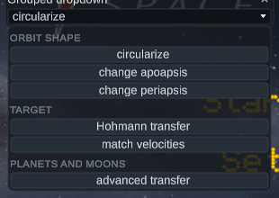

`ComboBox.Group = i => groupName` lists consecutive entries of a group under its header. The Maneuver Planner's 18
operations are sorted into Orbit shape, Target, and Planets and moons. The Node Editor's node and snap selectors, the
Custom Window Editor's window and preset selectors are dropdowns too (proposal 6A, instead of arrow selectors).

### Typeable drop-down (ComboModel)

`ComboBox` draws a Unity-free `Headless.ComboModel` (MechJebLibTest `ComboModelTests`): the open list's rows, the highlighted row,
the filter text, the typeahead and the pick; the selected value stays the host's (`get`/`set`).

- **Opt in:** `new ComboBox(...) { Filter = true, Keys = () => englishNames }`. With at least `ComboBox.FilterMinEntries` (12)
  entries the popup gets a filter field at its top and its rows are a `VirtualList`: only the rows in view are built (a planet
  pack's bodies, MuMech/MechJeb2#1583). A shorter list, or a drop-down without `Filter`, is built as before.
- **Typing** goes into the filter field (a TMP field: caret, Backspace, IME) while the popup's keyboard scope holds KSP's lock;
  the field has no scope of its own, so Up/Down/PageUp/PageDown/Enter/Escape stay the list's: Up/Down move the highlight, Enter
  picks it, Escape closes without a pick (and without a pause), Home/End are the field's caret. The entries are ranked by
  `FuzzyFilter` (label and key) best first; the best match is highlighted; clearing the filter brings the list back in its order
  with the selected entry highlighted. Nothing matching shows "No item matches." and Enter picks nothing; the field keeps the
  keyboard (Enter or a click on the scrollbar end its edit: the popup takes it back), with its caret kept at the end (TMP moves
  it to the start on Up). The popup is as tall as the rows shown, up to the room on screen, and shrinks with the matches.
- **Groups** (`ComboBox.Group`) are header rows while the filter is empty; a ranked list has none. The highlight skips headers.
- **Typeahead** on a plain drop-down is `TypeaheadModel`'s: letters typed within a second make a prefix ("ad" finds ADV), one
  letter steps through the entries starting with it.
- **Uses:** the Maneuver planner's operations (keys from the operation's type name, `OperationCourseCorrection` gives
  `CourseCorrection`), Delta-V Stats' TWR body (editor), Landing Guidance's sites once a pack makes them 12 or more.
- **Tests:** `ComboBox.Model`, `FilterField`, `VirtualRows` (rows by `RowAt`, picks through a row's `Entry` button).

A virtual list outside a window (the popup) passes its sync host: `new VirtualList<TRow>(addSync, parent, ...)`; a window's
`AddSync` keeps syncs for the window's life, so a popup runs its list's sync from a component destroyed with it.

## Edits and commits

Every widget that takes a setter (`Segmented`, `Stepper` and its field, `Field`, `Switch`, `Switch3`, `CheckBox`, `Chip`,
`Slider`, `ArrowSelector`, `SelectionGrid`, `ComboBox`, `MasterDetail`, `ColorPicker`) is a target on its window's commit
path, `w.Commits` (`Headless.CommitPath`, tested in MechJebLibTest). A user's edit runs the setter, then the window's
`Edited` (the owner saves its settings), then reports a `Commit`: the target (kind, key `Kind#n`, label, control), the value
before and after (read back from the getter: a field's normalised text), what was asked (a value, a typed text, a stepper's
delta), the source (`Pointer`, `Keyboard`, `Agent`, `Program`) and its actor (`ChangeActor`: a click and a key are the same
`User`; `Agent`; `Program`).

- **Keys belong to one window instance:** a lazily built panel (`LazyPanel`, `Section`) numbers its widgets in the order it is
  first shown, so a rebuilt window can give the same widget another `Kind#n` (focus recovery names fields by their place in
  the build instead, below). A target with a label also gets an `Id` from it
  (the label's key, or `label/Kind` when taken), which a rebuilt window gives the same control; a view can set `Id` itself.
- **Removing:** a view that destroys controls in a living window (a list's rows) calls `w.ForgetTargets(row.transform)` (or
  `w.Commits.Remove(target)`) first: the path lets the target go, its writes are refused, and `TargetRemoved` tells the undo
  stack to drop its entries. A view marks a group of its targets with `using (w.Commits.Tagging("executor"))` around their
  build, and a guard reads `target.Tag` (a lazily built panel inside the scope is built later, untagged).
- **Every setter call is a commit,** also one that changes nothing (`Changed` is false): the Translatron's OFF acts when picked again.
- **A gesture is one commit:** a slider's press and drag, a held repeat button, a field's edit session (focus to Enter, Escape,
  focus loss or the field hidden). The commit's `New` and `Count` follow it; observers see the same commit again.
- **Settled:** `w.Commits.Settled` fires once a commit is final: an ungrouped one right after `Committed`, a gesture's when it
  ends (the value a field's edit or a drag ended with). A settled commit never changes. A slider's track click, made before its
  drag's group opens, is its own settled commit; the drag's commit carries it on (`Replaces`, the same `Old`).
- **Who:** clicks report `Pointer`, typing and the drop-down's Enter `Keyboard`. A host that runs a widget's own handler for an
  agent wraps it in `using (CommitPath.As(ChangeSource.Agent))`, on the main thread; the outermost scope wins, and a host
  closes a scope left open (`CommitPath.ResetScopes`, once a frame in `KodeHost`). A held repeat button keeps its press's
  source. `target.Write(value, source)` sets a value through the path (an undo, an agent's write). Toggles and sliders changed
  by uGUI's own keys (Submit, arrows) report `Pointer`.
  Every Unity-side handler (graphs, timeline, lists, drags, toasts, dialogs, the editor's buttons) reports `KodeWindow.Pointer` or
  `KodeWindow.Source(ChangeSource.Keyboard)`, never the literal, so an outer `As(Agent)` wins there too:
  `HeadlessConventionsTests.EveryUnitySideHandlerReportsTheSourceAHostImposes` fails on a literal outside `Headless/`.
- **Observers** subscribe to `w.Commits.Committed` (and `Settled`), or to `KodeWindow.AnyCommit` for every window. They get the
  commits in order: one made by an observer waits until every observer has seen the current one; one made inside another
  target's setter is `Nested` and comes first. An observer that throws is logged and the others still run: the setter has run,
  so the widget goes on. An observer that keeps commits copies their fields (an open commit changes, and a kept one holds its
  window's controls) and unsubscribes from the static `AnyCommit` when it goes. `w.Commits.Log` keeps the last 32.
  `MasterDetail` and `ColorPicker` commit without calling `Edited`, as before the path.
- **Costs:** each edit reads the getter before and after the setter (a getter that throws stops the edit before the setter
  runs), and boxes the old, new and asked values: about 100 B per setter call, also for each frame of a drag.
- `ChoiceModel` and `StepperModel` take setters with a source, so their `LastSource` and the commit agree.

### Names and descriptions (what an agent and the pattern checks read)

Every control a factory builds has a name and, where the UI has a tooltip for it, a description: the agent bridge, the
pattern checks (`Patterns.Check`, Spike 141) and an accessibility tree read them from the commit target and its model.

- **The name** is the target's `Label` (a `'#key'` or a text, as the factory got it) and its model's `IDescribeParts.Label`
  (the same label as shown: localized, without a trailing colon). A factory takes it from, in order: its own text (a
  `SwitchRow`, a `CheckBox`, a `Chip`); the optional label parameter (`label:` on `Segmented`, `Tabs`, `Stepper`, `Slider`,
  `Switch`, `Switch3`, `SelectionGrid`, `EditFields.Field`, `EditFields.InlineEdit`, `EditUi.Field`; `name:` on
  `ComboBox`, `ArrowSelector` and an empty `CheckBox`, whose `label`/`text` parameters mean something else); a labelled row
  (`PropertyGrid`, `w.Named(control, label)`); else the label right before it in its row (`KodeWindow.LabelBefore`: the last
  child of the parent when it is a label, as the `'#key'` it was set from where it had one). A control after a switch, a
  button, a cell or another field has no label before it: pass one.
- **Keys follow the language:** a model named from a `'#key'` is named again on a language switch (the window's relocalize);
  so are `Segmented`'s items and a stepper's field. A name built from a shown text ("Latitude °") stays in the language the
  window was built in until it is rebuilt.
- **The id** comes from the label (`Id`: the key or text, or `label/Kind` when taken), after the lazy panel or section it was
  built in (`CommitPath.NameScope`, "p3/", numbered when the window makes the panel): the planner's 16 operations each name
  their time selector `p<n>/#MechJeb_Maneu_STB`, the same whichever operation the player opens first. A control with a label
  has one, for an observer (the agent bridge). Focus recovery doesn't use it: it names a field by the view's name or its place.
- **The description** is `CommitTarget.Description`, read when asked (nothing is looked up while a window is built): one a
  view sets (`target.Description = …`, the PSG Stages check boxes take their column's tooltip), else the path's `Describer`,
  which KodeKit sets to `KodeWindow.DescribeTarget`: the tooltip of the label's key (`TooltipFor(key)`, `key + "_tooltip"`
  in the language now), else the tooltip a view put on the control or next to it (`KodeWindow.TooltipNear`: on the control or
  inside it, else on its row and up to two levels more while that row holds no other control and the tooltip is on no other
  button).
- **`Headless.ControlInfo.Of(target)`** reads a control as an agent sees it: kind (`switch`, `checkbox`, `choice`, `tabs`,
  `list`, `switch3`, `stepper`, `text`, `inline`, `combo`, `slider`, `cycle`, `grid`, `chip`, `items`, `colour`), label,
  description, value, entries and actions (the model's verbs). It allocates: never per frame.
- New `'#key'` names for controls with no text on screen are `#MechJeb_NewUI_Label_*` in `en-us.cfg` and `zh-cn.cfg`.

### The agent bridge (KodeKit/Agent)

For tests and full control of MechJeb from an agent (an MCP client, a test, curl): `UiAgent` lists and drives the windows on
screen, `AgentServer` serves it over HTTP on 127.0.0.1. **Off unless KSP is launched with `-mechjeb-ui-agent <port>`** (or `-mechjeb-ui-agent=<port>`; the environment variable `MECHJEB_UI_AGENT_PORT` still works without the argument): `KodeHost` starts the
server from it, and while it is off the bridge costs one `Running` check a frame. No confirmation step (`UiAgent.Allow` stays
an optional hook).

- **What it lists** (`UiAgent.Collect(window)`, made fresh for each request, nothing registered at build): every commit target
  whose control is shown (ref `w<serial>.<Kind#n>`, kind, label, description, value, entries and actions from
  `ControlInfo`); the window's other buttons (`w3.b<n>`, pressed through uGUI's event system), folding headers
  (`KodeWindow.Disclosure`, `w3.d<n>`), live read-outs (`w3.r<n>`), meters (`KodeWindow.MeterHandle`, `w3.m<n>`: kind
  `meter`, the model's sentence as the value, the scale as `range`, read-only), tables (`TableGridHandle`, `w3.t<n>`), the
  open dialog (`dialog`) and the open command palette (`palette`: its query as the value, its results as the items; `type`,
  `enter`, `pick <n>`, `up`, `down`, `close`; a flight command runs on the second `enter`, as for a person; while it is open the
  windows' controls refuse, as behind a dialog). A hidden control is absent; a disabled one (its model, its Selectable or a CanvasGroup above it) has no actions.
  **Where it acts as a person can, and where not:** while a dialog is open only the dialog takes a step (a window's step is an
  error naming the dialog, `/undo` too, and the snapshot marks the windows `blocked`), as its blocker takes a person's clicks.
  It differs on purpose, for tests and full control: it acts on a control covered by another window or scrolled out of its
  list, runs up to 100 steps in one frame (Engage and Disengage with no frame between), undoes over every window's history
  (closed windows included), and acts with no confirmation.
  **Refs don't move:** a commit target's ref is its key (never reused); a button's, header's, read-out's or table's number is
  given the first time the bridge lists it and kept for the window's life (`Headless.StableRefs`), so a ref kept across a fold or
  an autopilot's button swap names its control or nothing ("no control"), never the control that took its place. A step names
  its control by `ref`, by `id` (only an id matches it), or by a label (`Headless.ControlMatch`: a text two controls share, as
  label or id, is ambiguous).
- **Names that are the same in every language** (for a mod that drives the UI in-process, `UiAgent.Resolve(null, id, within,
  "press", out err)` then `UiAgent.Run`, or a step `{"id": …, "within": …}`):
  - **A button's id** is the `'#key'` its text was built with (`KodeWindow.Button`, the role overload, `ListRow`,
    `HeaderButton`, `TitleButton`, `RepeatButton`) or its tooltip's (`TitleIcon`: Undo, Redo, the custom windows' icons), after
    the lazy panel's or section's build scope as for targets (`p3/#MechJeb_Maneu_button1`); the close button's is `Close`. A
    view names any other button with `KodeWindow.NameButton(b, name)` (an icon button). The factory stores the name once, in a
    `ButtonName` component; the bridge numbers the window's buttons of one name in hierarchy order, hidden ones included
    (`Headless.ControlMatch.ButtonIds`: the second is `name/2`, and an id a commit target of the window has takes `/button`), so
    an id is unique in its window and the same after a fold, a rebuild and a language switch. A button whose text is a plain
    string, or only an icon, has no id (its ref, its label or its place still name it). A text set by key after the build
    (`SetText` on its label) is used too, without a scope.
  - **A step's id without the scope:** when no control has the id exactly, the one shown control whose id is it after its build
    scope (`ControlMatch.Unscoped`: `#MechJeb_Maneu_button1` names `p0/#MechJeb_Maneu_button1`, the planner's creation bar being
    in a lazy section); two shown are ambiguous. Only the shown panel's controls are listed, so a key repeated across the
    planner's operations names the shown operation's control. Targets' ids take the same rule.
  - **A window's module** (`KodeWindow.ModuleName`, set by `KodeView`): its display module's type name
    (`MechJebModuleManeuverPlanner`), or `CustomInfoWindow:` and the custom window's saved id (`CustomInfoWindow:Delta_V_Stats`;
    the id stays when the window is renamed). `within` matches it whole and case-insensitive (`ControlMatch.InWindow`:
    `MechJebModuleAscent` doesn't name `MechJebModuleAscentSettingsMenu`), as well as the window's ref (exactly) and a part of
    its shown title (case-insensitive, in the language now). The snapshot gives each window `module` and `id` (the same name),
    a query's match and an act's values `window` and `module`, the change feed's records `module` (and a press its button's `id`).
  - All of it is added to protocol **version 2** (new fields and matches only; nothing an old client sends changes meaning,
    except that a `within` equal to a module name now also names that window).
- **What an action does:** a value control's action calls its model (`ControlActions.Run`) inside
  `CommitPath.As(ChangeSource.Agent)`: one commit with the source Agent, on the path a click takes. A field's or a stepper's
  `set` types into its `TMP_InputField` as one edit (select, the text, Enter, focus off), so the view's own end-of-edit
  listeners run as for a person. A table's selection and a header's fold are view state (no commit); a dialog's answer is no
  commit (its action is).
- **The change feed** subscribes, while the server runs, to `KodeWindow.AnyCommit` and `AnySettled` (a record per commit,
  again as a gesture goes on, and one when it settles: `type` "commit"), `KodeWindow.AnyAction` (a button pressed, "press",
  before its action runs; a header folded, "fold"), `TableModel.AnyHidden` ("hide", a column hidden), the dialog queue
  ("dialog": shown, then its answer with its source) and `WindowBehaviour.AnyShown` ("window": shown or hidden, with its scene
  too). Each record has its source and actor. A change made by code outside the controls is not in it. Nothing is polled per
  frame. The answer carries the launch's `session`, the `oldest` record kept, `dropped` when records after `since` were
  overwritten (500 kept) and `reset` when `since` is past this launch's last record.
- **Undo by source:** `/undo {"source": "agent"}` is `KodeWindow.History.Undo(ChangeSource.Agent)`: only windows whose view
  opted into undo (`w.UndoButtons()`, or a test setting `w.Undo.Recording`) record changes; the bridge doesn't opt any in.
- **The wire** (protocol `version` 2 in every answer, `GET /` gives it with the launch's `session`): `GET /snapshot`, `/query`, `/changes?since=n`, `POST /act {"steps": [...]}`, `POST /undo`; the token in
  `X-Agent-Token` (`MECHJEB_UI_AGENT_TOKEN` or the file `PluginData/agent-token`); a request with an `Origin` header is
  refused. MechJeb2_UI's `Tools/mechjeb-ui-mcp/server.py` is the MCP server on it.
- **Load:** the server reads and waits on 4 threads of its own (not the ThreadPool MechJeb computes on), with 8 more requests
  queued; one past that is answered 503 at once. A body must arrive within 5 s (else 408, nothing run). With no host pumping (the main menu, the space
  centre, a scene loading, the game in the background) a request is answered 503 at once, and those waiting when the scene ended
  are dropped (503), never run in the next scene. The server stops when the game quits.

### What goes through the commit path, and how models tell their host

- **In: a change of module state the player would call an edit.** A value set (every widget above), and a list of a module edited
  in place: the custom window editor's item list is one target (`ItemList`, the editor's `ItemsTarget`) whose moves (drag,
  Move up/down), adds (a registry drop or click) and removals (Remove) are commits with the source of the gesture, so
  `AnyCommit`, the bridge's change feed and `Settled` see them. Its `State` (the item list and the selection, restored only
  while the same window is edited) is what an undo stack would take back once the editor opts into undo (`UndoButtons()`; it
  doesn't yet).
- **Out: view state,** which no module stores and no undo should take back: a graph's pan and zoom (`ViewportModel`), the range
  and points picked on it (`RangeModel`: a selection over recorded data, kept by the view across rebuilds), a timeline's
  selected item (`TimelineModel`), a drop-down's open list and highlight, a tree's folds, a list's scroll. These models keep a
  `Version` the view polls and a `LastSource` of their last change. An edit made from them (a timeline pick that selects a node,
  a range that a view turns into a setting) is the view's commit on a target of its own.
- **Out: actions that make or remove modules,** which no undo could put back in place: Delete window and Restore factory
  defaults run from a dialog's confirm action and post a toast. A dialog's answer is not a commit; the action it runs is the
  edit.
- **Notifications are events.** A model tells its host and any other observer (a test, the agent bridge) with C# events:
  `ChoiceModel.ShownChanged`; `ComboModel.RowsChanged`, `HighlightChanged`, `Closed`; `DialogModel.Closed`, `ActionFailed`;
  `DialogQueue.Opened`, `Hidden`; `KeyboardScopes.Changed`; `KeyScope.Key`, `Typed`, `Dismissed`, `LockChanged`;
  `TimelineModel.Picked`; `TreeReorder.Moved`; `ToastQueue.Posted`, `Closed`; `InputHistory.Changed`; `CommitPath.Committed`,
  `Settled`, `TargetRemoved`, `ObserverFailed`; `UndoStack.Failed`. A second subscriber never silences the view.
- **Owner callbacks stay single:** a delegate that decides or performs what the widget does belongs to its owner and is set once:
  `Allow` (Choice, Stepper, Transfer), `ReorderModel.IsFixed`, `UndoStack.Guard`, `DialogModel.OwnerAlive`, `OnConfirm`,
  `OnCancel`, `OnOther`, `ComboModel.Group`, `CommitPath.Edited` (the window's save).

## Undo and redo

Each window has an undo stack over its commits, `w.Undo` (`Headless.UndoStack`, tested in MechJebLibTest), and every
window's stack is in one history, `KodeWindow.History` (`Headless.UndoHistory`).

- **Opt-in:** a stack records nothing until its view calls `w.UndoButtons()` (or sets `w.Undo.Recording`), after setting its
  guard; a window whose setters engage a flight mode doesn't opt in, or marks those targets `Undoable = false` (PORTING.md).
- **An entry is a commit:** a gesture (a slider drag with its track click, a held repeat button, a field's edit session) is
  undone at once. A commit that changed nothing is not an entry, nor is a target that isn't `Undoable` (`MasterDetail`'s row,
  `ColorPicker`: the targets that don't persist), nor a `Nested` commit (an outer setter's side effect).
- **An undo writes through the target** (`target.Write(old, ChangeSource.Undo)`): the path records it with the source
  `Undo`, observers and the bridge see it, and the stack records no entry for it, so a redo stays possible.
- **A target's state:** when a control's value isn't the whole of its change, the view gives the target an `IUndoState`
  (`target.State`): the commit keeps the state before and after, and the undo restores it. An entry is then a change of the
  state: typing that hasn't reached it is no step. The node editor's Δv and time fields write texts; their state is the
  node's burn and time, so undoing a + moves the node back, and a typed Δv is a step once Enter applies it to the node.
- **Stale and guarded:** before writing, the stack checks the control still shows the entry's value, or for a state target
  that the state is still what the change (or the last redo) left: a gizmo drag since makes the entry stale. A state's
  `Restore` can refuse too (the node was executed). A stale entry writes nothing and is dropped. `w.Undo.Guard = target => …`
  holds an undo while the owner forbids it (the node executor flying a node): the entry waits.
- **By actor:** `w.Undo.Undo(ChangeSource.Agent)` and `KodeWindow.History.Undo(ChangeSource.Agent)` revert an agent's (or a
  test's) own latest change; the filter goes by actor, so `Pointer` and `Keyboard` are both the player. An entry whose control
  someone else changed since is refused (`Conflict`). An undo's commit has the source `Undo` and, as its actor, who undid (the
  player's click on the icon, an agent through a host's scope).
- **Re-entrancy:** an undo or redo asked while another writes (from an observer or a setter) returns `Busy`; a write that throws
  keeps its entry and returns `Failed` (logged). The stack records each commit before `AnyCommit`'s observers see it.
- **Clearing:** a new edit drops the redo entries of its actor and those on the same control; a removed target (a destroyed
  row) takes its entries with it; 50 entries per window; a rebuilt window (a language switch, a layout change) starts empty,
  because its targets and keys are new (the old stack leaves the history when its view is destroyed). A field edit going on
  across the rebuild becomes the new stack's first entry, from the value before the edit, once it changes the value again
  in the rebuilt window (focus recovery, below); an edit ended there with nothing more typed makes no commit in the new window.
- **The UI:** `w.UndoButtons()` adds undo and redo icons to the title bar, greyed when there is nothing to do or the guard
  holds it. There are no undo keys: with no field focused Ctrl and Z are KSP's throttle keys, and an edit ends (Enter) before
  its mistake is seen, so a chord would reach the vessel. The Maneuver Planner and the Node Editor have the icons.

## A field across a rebuild (focus recovery)

A field being edited keeps the keyboard when its window is rebuilt: `RebuildRequested`, a language switch, the section headers
setting (`Headless.FocusRecovery`, tested in MechJebLibTest; KodeKit's side is `FieldFocus` on every field and
`KodeWindow.Focus`).

- **When:** `KodeView.Destroy(rebuilding: true)` calls `w.RememberFocus(module)` before the window goes, and `KodeView.Build`
  calls `w.RecoverFocus(module)` once the new one is built. Only a destruction the host follows with a build of the same module
  remembers (`RebuildRequested`, a language switch, the section headers setting); a window closed for good (a vessel switch,
  "Restore factory default settings" recreating the modules, a destroyed core) ends its field's edit at once with
  `w.EndFocusedEdit()`, as a focus loss, while its view and module are still there. Any KodeKit host does the same with its own owner object. With no field
  focused, both cost one check and allocate nothing.
- **What:** the field's text as typed (also when the view keeps typed text apart from the model, as the Settings scale field
  does), its caret and selection, its text at focus (what Escape puts back), and its edit's open commit.
- **Which field:** by its stable name where it has one (`FocusKey` "Kind=name"): the name the view gave it
  (`field.Named("item:" + id)`: a custom window's editable items), also its target's `Id`. Otherwise by its kind and place in
  the build ("Kind:place"): the lazy panel or section it is in (`LazyPanel`, a lazy `Section`, numbered when the window makes
  it, not when it is first shown) and its order there. A target `Id` taken from its label is not used: two fields of one kind
  and label in one panel would share it (the second gets none), and a field found by its place is checked against its value
  (below), which an Id isn't.
- **Not another field:** a field found by its place must also show the same value (`FocusCheck`: its target's value
  text, which typing has already set, or the edit's text at focus: a view that keeps the typed text apart until the
  edit ends, as the Settings scale field, shows the model again once rebuilt): a rebuild that added or removed a field before it puts another value's field at that
  place, and that one is `Mismatched`: it gets no edit, and the old field's held actions run as at a focus loss. A field the
  view named is found by its name alone, wherever it moved.
- **The names of a control:** `CommitTarget.Key` ("Kind#n", the order of creation in one window instance) names it within the
  window for its undo entries and logs; `CommitTarget.Id` (its label's key, or the view's name) names it for an observer (the
  agent bridge); `FocusKey` (the view's name, else the place) names it across rebuilds. A view that names a field gives both the same name.
- **Input history:** a field opted into its input history records nothing while its edit is held: handed over, the rebuilt
  field records the edit's real end (not the text typed so far, which the old field's deselection settles); ended, the held
  commit is recorded then.
- **One edit, one commit:** the remembered field holds back its end-of-edit actions (its `onEndEdit` listeners: a view's
  typed value applied on focus loss, the node editor's apply). When the rebuilt field takes the edit over they are dropped, and
  the new field's run once, at Enter, Escape or focus loss. Its group carries on the old commit (`ContinueGroup`: `Old` from
  before the edit, `Replaces` the old commit), so the rebuilt window's undo stack has one entry for the whole edit.
- **Gone:** no field of that name, two of them, or one hidden (the planner showing another operation): no field gets the
  keyboard, and the old field's held actions run as at a focus loss. Focus never moves to a neighbour: a focused field holds
  KSP's keyboard lock, and the flight keys would be gone without the player having clicked a field.
- **The lock:** the new field takes its own lock when it is selected, the old one's goes with its field: the lock is held across
  an immediate rebuild (`RebuildRequested`, a language switch: the window is built again in the frame it is destroyed). A rebuild
  the settings ask for (the section headers) destroys the windows in that frame and builds them in the next: the lock is
  released for that one frame. An edit not recovered by the next frame is dropped (its window was closed).
- **Not a rebuild:** a skin change restyles the windows in place (the field stays, with its focus); a lazy panel hidden
  (the planner's operation switch, a folded section) hides its field, which ends its edit and releases the lock (no recovery when
  the panel shows again).

## Recent values in a field (input history)

A field can offer the values the player committed in it before: while it has the keyboard, Up shows an older value and Down a
newer one (`Headless.InputHistory` and `InputHistoryBrowser`, tested in MechJebLibTest; KodeKit's side is `FieldHistory` and
`KodeWindow.InputHistory`).

- **Opt in per field:** `EditFields.Field(...).History("planner.apoapsis")` (also `EditUi.Row`, `OpUi.LabeledField` and
  `AscentUi.SimpleBox` take a `history` key). Today: Ascent Guidance's target altitude (PSG periapsis and classic orbit
  altitude share `ascent.altitude`), apoapsis and inclination; the planner's New periapsis/apoapsis/semi-major axis/inclination
  and its burn time ("X from now", the altitude); the Warp Helper's time and lead time.
- **The key** names what the field holds and is chosen by the view: the same in every language, rebuild and MechJeb version,
  so the saved lists stay with their quantity. Not the target's `Id` (a localized label in places) nor the field's place in the
  build (focus recovery's name, which moves when a window's layout changes). Fields of one quantity share a key (Change
  apoapsis and Change both's New apoapsis).
- **The walk:** the first Up keeps the text in the field (the typed text) and shows the most recent value; values equal to the
  typed text or to the field's text are passed over. Down past the most recent brings the typed text back. Typing ends the walk.
  The value shown is typed into the field as a key would (the model has it at once, in the edit's commit), the caret at its end:
  Enter commits it, Escape puts back the text from before the edit, as for any edit.
- **What is recorded:** the field's settled commit of the player (Enter, or focus loss) that changed the value and parses. Not an
  agent's (the bridge's source scope), not the program's, not an undo's (`ChangeSource.Undo`, whoever asked), not one made inside
  another control's setter. A value already in the list moves to the front; a list keeps 8 values, the history 64 keys (the key
  recorded into least recently goes), values up to 40 characters.
- **Keys:** plain Up and Down only while the field has the keyboard, so KSP's keyboard lock is held and the arrows never reach
  the camera; with no focused field they are KSP's. Shift+Up/Down keep TMP's selection; with Ctrl or Alt nothing happens. Not
  on a stepper's field, whose Up and Down nudge (`History` leaves it unchanged); a drop-down of recent values, which a stepper
  could use, would be a section in the typeable drop-down (`ComboModel`; not done). `FieldHistory.Step(older)` does what the keys do, for a host with no keys (the
  agent bridge, a test); it types as the player unless the host wraps it in its source scope (`CommitPath.As(Agent)`), so the
  bridge must, or the edit it commits is recorded as the player's.
- **What it replaces:** in these single-line fields Up moved the caret to the start and Down to the end (TMP). When the key has
  a value to show, Up/Down now show it with the caret at the end; with nothing to show (no list, or Down when not walking), TMP's
  caret jump still happens.
- **Not shown to the player:** nothing on screen says Up/Down recall values; a tooltip line on the opted-in fields or a
  recent-values section in the typeable drop-down would.
- **Lifetime:** one history for the game (`KodeWindow.InputHistory`): a rebuilt window, another window and another scene offer
  the same lists. `KodeHost` saves it with MechJeb's global settings (`MechJebModuleSettings.InputHistory`, an `InputHistory`
  node in `mechjeb_settings_global.cfg`, one `FIELD` per key) and reads it from the first global settings loaded in a game
  session; Restore factory defaults clears it.
- **Cost:** the component is enabled only while its field has the keyboard (no per-frame cost otherwise); a step of the walk
  allocates nothing; a record that changes a list makes the settings node again (a few hundred bytes, once per edit).

## Input widgets on models (text field, switch, check box, Switch3, slider)

Each input widget draws a headless model, tested in MechJebLibTest: the model is the control's commit target's `Model` (and a
field's `FieldText.Model`), and a click, a key and an agent's call run the same model code. The value side is shared: a
`ValueModel<T>` holds the getter, the setter (the commit target's `Set`, which takes the source), the `enabled` check, an
`Allow` owner callback, what is shown (`Shown`, `Version`, the `ShownChanged` event the widget repaints on) and `LastSource`.
Each widget's model adds thin rules:

| Widget | Model | Rules |
|---|---|---|
| `EditFields.Field`, the stepper's field, a dialog's prompt | `TextFieldModel` (`TextCommit.AsTyped`) | the edit opens when the field is selected and is one commit (the session, focus to the end); each typed text is written at once and the field shows what the value kept; Enter and a focus loss end it; Escape writes the text the edit began with back (the model reverts: TMP's own restore is off); validity is the value's own check, read once a frame |
| `EditFields.InlineEdit` | `InlineEditModel` (`TextCommit.AtEnd`, a `TextFieldModel`) | typing changes a draft; Enter or a focus loss writes it once; Escape drops it; an invalid draft is refused at Enter (see below) |
| `Switch`, `SwitchRow`, `Toggle`, the property grid's switch rows; `CheckBox` | `ToggleModel` (`ToggleKind.Switch`, `CheckBox`) | one setter call and one commit per change; `Flip` turns the value as it is now; a refused change puts the toggle uGUI moved back |
| `Switch3` | `Switch3Model` | a click on another third sets it; the knob's own third calls nothing; a position outside is refused |
| `Slider` | `SliderModel` | clamped to its range (and a step grid when it has one); a press and its drag are one gesture and one commit (`BeginDrag`, `EndDrag`); its keys only through a keyboard scope |

- **For a host without a pointer or keys** (the agent bridge, a test): `ToggleModel.Flip(source)`, `Switch3Model.Pick(i, source)`,
  `SliderModel.BeginDrag()`, `Set(v, source)`, `EndDrag()`, and a field's `TextFieldModel.Begin()`, `Type(text, source)`,
  `Submit(source)` or `Cancel(source)`. The widget shows the result in the same frame (a toggle, a knob, a handle) or at the
  next sync (a field not focused shows the model's text). These calls take the source as an argument; `CommitPath.As` is only
  needed around a widget's own uGUI handler.
- **Keys:** the models handle Space and Enter (toggles), Left/Right/Home/End (Switch3) and the arrows, PageUp/PageDown,
  Home/End (slider), for a host that routes them through a keyboard scope. KodeKit routes none of them: a clicked toggle or
  slider doesn't take KSP's keyboard, and the slider's uGUI navigation is off, so the arrows (KSP's camera keys) never move it.
- **What is left of TMP's privates:** `m_ShouldActivateNextUpdate`, cleared when an edit ends in the frame it opened (TMP
  would select the field again in its next `LateUpdate`; no public member clears it). The text at focus (`m_OriginalText`) is
  no longer read or written: the model keeps it (`Original`, `Resume` for focus recovery).
- **Cost:** each widget's sync is the model's getter call and a compare: nothing allocates.

## Where a field's text lines up (FieldKind)

A field says what it holds, and that sets its text's horizontal alignment; its vertical alignment stays as it is (top in a
plain field, middle in the stepper's box):

| Kind | Alignment | Fields |
|---|---|---|
| `FieldKind.Number` (the default) | right, like the read-outs of a value column, so the digits of fields under one another line up | every field on a MechJeb editable (`EditUi.Field`, `EditUi.Row`, `EditUi.Grid`, `EditUi.Inline`: an `IEditable` always holds a number, or `EditableIntList`'s numbers), `OptionRows`' limiter fields, and the views' own number fields on a `.Text` (refresh rates, inclination, Max AoA, UI scale, phasing altitude, docking distances, waypoint radius, speeds and coordinates, the flight recorder's history size) |
| `FieldKind.Text` | left | names and titles (Custom Window Editor title and header, waypoint route name), filters (the editor's item filter, the combo box's filter, the command palette's query), a dialog's prompt |
| `FieldKind.Centred` | centre | the stepper's field, between its - and + buttons |

- **Where it is decided:** at the factory. `EditFields.Field`, `EditFields.InlineEdit` and the property grid's `Field`,
  `Switch` and `InlineEdit` take `kind`, `FieldKind.Number` when left out, since most of MechJeb's fields hold numbers; a view passes
  `kind: FieldKind.Text` for a text field (a name, a title, a filter, a prompt). `Stepper` passes `Centred`.
- **A number wider than its field** (after the field widened to 1.6 times its width): out of an edit it shows its start, so
  its sign and leading digits stay visible (the field lines it up on the left while it overflows); in an edit TMP scrolls the
  text to the caret in either alignment, and the field goes back to its alignment once the value fits (a centred stepper value too). The check runs when the
  text changes and when focus changes, never per frame.
- The combo box's value on its closed button is on the left, like its list's rows; the `[<] entry [>]` form (MechJeb's "no
  drop-down menus" setting) keeps its entry centred between the arrows: it has no list to match.
- `EditFields.Align(input, kind)` sets it on a field made another way (it changes the text's and the placeholder's
  horizontal alignment only, once: a restyle sets the font, size and colour, not the alignment).

## A read-out edited in place (inline edit)

A value shown as text that turns into a field when clicked, in place (`Headless.InlineEditModel`, tested in MechJebLibTest;
KodeKit's side is `EditFields.InlineEdit` and its `InlineEdit` component; `PropertyGrid.InlineEdit` for a grid row). On a
MechJeb editable only: `EditUi.Inline(grid, label, editable, unit, width, colour)`, whose parse check is the editable's
`Parses(text)` (`EditableDoubleMult`, `EditableTime`, `EditableInt`).

- **Use:** a window that is mostly read-outs, where a field per value would make it read as a form: custom info windows draw
  their editable items with it (the Rover's Speed and Heading, the Hoverslam settings, the RCS balancer precision). Where a
  value is edited often and has − and +, keep the Stepper (the node editor's Δv and time shift).
- **The read-out is the field:** one `EditFields.Field` drawn as text (its box hidden, a thin rule under the value, the box
  shown on hover), so opening the edit changes no rect and the window doesn't move. Anything that gives the field the keyboard
  opens the edit: a click, focus recovery's take-over after a rebuild, a host's `InlineEdit.Open()`.
- **Typing goes to the draft only:** nothing reaches the value until the edit ends. Enter or a focus loss writes the draft once
  through the field's commit target (kind `InlineEdit`), one settled commit, unless it equals the value's text. Escape drops
  the draft: no write, no commit, nothing recorded. That differs from `EditFields.Field`, which writes every key. The draft is
  cleaned as the editable keeps its text (`normalise`; `EditUi` passes the editable's `Normalise(text)`, its junk strip): a
  letter typed shows nothing, as in a plain field ("1x5" shows 15). A double keeps `e` (scientific notation), so "15e" stays
  and doesn't parse.
- **What ends an edit as a focus loss (and writes the draft):** a click anywhere else, the 3D scene included; the window closed
  or anything else hiding the field during the edit (TMP ends the edit from its `OnDisable`). A field hidden before TMP gave it
  the keyboard (the frame after the click) drops the edit instead: nothing was typed yet.
- **Invalid text:** red while it doesn't parse (checked when the draft changes); Enter is refused and the edit stays open with
  the keyboard; a focus loss ends the edit with the value as it was.
- **The value changing during the edit:** a draft not typed in yet follows it (and Escape returns to the new value); once the
  player typed, the draft is kept and wins at Enter (`Stale` says the value moved).
- **Read-only:** the `enabled` check false dims the read-out and takes no click; becoming read-only during an edit ends it
  without writing.
- **With the other items:** the field's keyboard scope keeps KSP's keyboard lock until Enter or Escape is up (Escape opens no pause menu);
  `.History(key)` works on it (Up/Down walk the draft, the commit at Enter is recorded); the commit lands in the window's undo
  stack when the window opts in (`UndoButtons()`; custom windows don't: their toggles can engage an autopilot); focus recovery
  carries an open edit across a rebuild.
- **For a host without a pointer or keys** (the agent bridge, a test): `InlineEdit.Open()`, the field's text for typing,
  `Submit()` (as Enter) and `Cancel()` (as Escape).
- **Cost:** the read-out's per-frame sync allocates nothing (an enabled check and the look, restyled only on a change).

## Keyboard scopes (who has the keyboard)

Anything that takes the keyboard (a focused field, an open drop-down, a dialog, the command palette) opens a keyboard
scope: a `KeyboardScope` component on an object that lives as long as its owner, on one shared stack
(`Headless.KeyboardScopes`, tested in MechJebLibTest). A field's is `FieldKeyboardLock`, made by `EditFields.Field`; a
`ComboBox` has one on its button.

- **The lock:** an open scope holds KSP's `ControlTypes.KEYBOARDINPUT` under its own lock id (`KodeKitField_<id>` for a
  field, `KodeKitScope_<id>` otherwise), so a key typed there doesn't also fly the vessel. Closed, it keeps the lock until the
  frame after and until Escape and Enter are up (KSP opens its pause menu on Escape's key-up). Disabled or destroyed (its
  window hidden or closed), it lets the lock go at once; a scope whose owner is gone is removed from the stack.
- **The keys:** the top scope alone gets the keys it routes (`Configure(routes, takesNavigation)`, then the scope's `Key`,
  `Typed` and `Dismissed`): Up, Down, PageUp, PageDown, Home, End, Left, Right, Tab, Enter, Escape and typed letters and
  digits (a scope reads Shift itself). Escape closes
  the top scope only. A key held as the top changes reaches the new top only once it came up: the Escape or Enter that ended a
  field doesn't also close or pick in the drop-down under it. A field routes only the keys its helpers ask for
  (`FieldKeyboardLock.Route(keys, handler)`: a stepper's Up, Down, PageUp and PageDown, the input history's Up and Down, a
  prompt's Tab; TMP reads the text keys itself) and covers the scopes under it. Every key a KodeKit widget reads comes this way:
  a stepper under a dialog doesn't nudge, and no helper reads `Input` for its keys.
- **A drop-down's filter** is a field of the drop-down's scope, not a KodeKit field: no scope or lock of its own (the popup's
  holds the lock and routes every key; the field types its letters), no commit target, no focus recovery. It takes the keyboard
  back after Enter with no match or a click on the scrollbar only while the popup's scope is on top: a dialog opened over the
  open list keeps the keyboard, and letters typed then don't filter the list under it.
- **uGUI's navigation:** off while an open scope takes it (a drop-down: the arrows and Enter would move and submit an unseen
  EventSystem selection), put back when the last one closes. A field leaves it on.
- **API:** `Lock()` opens the scope on top, `UnlockAfterKeys()` closes it, `Unlock()` drops it at once; `Locked` and `LockId`
  for tests; `KeyboardScope.Scopes` is the stack (`Top`, `OpenScopes`, `LockWanted`, `NavigationOff`).
- **Cost:** nothing runs per frame while no scope holds a lock: one shared driver reads the keys and lets locks go, enabled only
  then. A field's scope has no update of its own.

## Keyboard shortcuts (opt-in window toggles: ShortcutMap, ActionRegistry, `Shortcuts`)

A chord (a key, alone or with Shift or Control held, either side: a bare F8 is a chord) bound by the player to an action of the shared registry
(`Shortcuts.Actions`, a `Headless.ActionRegistry`: id, label, kind, `Run`, `Available`; the command palette reuses it). MechJeb
registers every menu window as a toggle (`window:<module type>`, `window:custom:<name>`; `MuMech.UI.WindowShortcuts`) and saves
the bindings in its global settings (`UiShortcuts { SHORTCUT { action, chord } }`; a custom window's name is saved with `%XX` for
`{ } = / %`, a newline, a tab and a space at either end, which ConfigNode would read as syntax or trim). Two custom windows with
one name share one id: the registry keeps the first, so the chord toggles it and the other can't be bound until it is renamed.
**None is bound by default**, and no action engages an autopilot.

- **The rules** (`Headless.ShortcutMap`, tested in MechJebLibTest): every key a chord presses, its modifiers included, is tested
  against the keys KSP reads at run time: every `KeyBinding` of `GameSettings` (its statics and the custom axes' keys), read by
  reflection, plus a table of keys KSP's code reads itself (`ShortcutMap.KspHardCoded`: Tab, the editor's Ctrl/Cmd+Z and +Y,
  Delete, Insert, BackQuote, the wheel keys, the menus' arrows, the space centre camera's 0-3, PageUp, PageDown and C, the Mission Builder's Backspace and Ctrl+C/V, MODIFIER_KEY+L, +X and +F12 with whatever MODIFIER_KEY is). So Left
  Shift and Left Ctrl (KSP's throttle) are refused and the right-hand ones are not, unless the player bound them. Alt chords are
  refused (MODIFIER_KEY, the trim keys, Alt+F12), and Command or Windows chords (the system's); Escape, Enter and Tab are the
  windows' own keys. Two actions on one chord is refused at bind time. A refusal comes with its reason (`ChordCheck`: the
  problem, the binding's name or the code's file and line, the other action); `Shortcuts.Describe` says it in words for the player: KSP's own localized name of the binding where KSP has one ("W is KSP's \"Pitch Down\" key."), else "a key KSP uses"; the field names and file:line stay in the code and the log. A binding whose action is gone (a custom window renamed or deleted) shows as "missing window <name>" and has its own Clear in Settings, like every listed binding.
- **Live check:** the keys are read again on `GameEvents.OnGameSettingsApplied`: a KSP key rebound onto a bound chord leaves the
  binding in place, shows it as conflicting (the menu draws its chord in the Bad colour, the Settings row says why) and stops it
  firing until the key moves away. A saved chord that KSP reads now is kept the same way.
- **When nothing fires:** while a keyboard scope holds its lock (`KeyboardScope.Scopes.LockWanted`: a field, a drop-down, a
  capture), while the game is paused (`FlightDriver.Pause`: the pause menu, KSP's settings and key capture opened from it,
  the space centre's menu; the pause lock leaves `PAUSE` out of the full mask), while KSP's whole keyboard lock is taken (`(LockMask & KEYBOARDINPUT) == KEYBOARDINPUT`; never `IsLocked`, which any
  partial lock such as Alt+L's stage lock trips), while uGUI's selected object is a text field or an IMGUI control has the
  keyboard, under any popup layer (a drop-down's list, a context menu, a dialog), and when the action can't run (MechJeb's UI
  hidden, the window not in the menu). A chord fires with exactly its modifiers held.
- **Capture:** the Settings window's Keyboard shortcuts group: pick a window, press its chord button, then the chord. The
  capture holds a keyboard scope (KSP's keyboard lock) until every key is up, so the key pressed to try a chord doesn't also fly the vessel; a
  modifier alone waits for the key; Escape or a click cancels. The menu shows a bound chord after its window's entry.
- **Names:** a key shows as KSP's settings screen names it (the keyboard layout file's KEY_MAP, else the KeyCode's name:
  `RightControl+Y`); a chord is saved by KeyCode names, the same on every layout.
- **Cost:** a shared driver (`KodeKitShortcuts`) runs only while a chord is bound or a capture is on; it calls `GetKeyDown` on
  the bound keys only, and reads the modifiers only when one went down. A poll allocates nothing. MechJeb's `WindowShortcuts.Follow` runs every frame from KodeHost: two compares, and the window list's signature once a second.

## Command palette (PaletteModel, `CommandPalette`, MechJeb's `PaletteCommands`)

Type to find a window, an autopilot or a maneuver node command and run it. It opens from the menu's "Command palette…" button,
or from a keyboard shortcut bound to its action (`palette:open`, kind `UiActionKind.Command`, in Settings > Keyboard shortcuts);
**no key is bound by default**.

- **The model** (`Headless.PaletteModel`, tested in MechJebLibTest, `PaletteModelTests`): the commands (`PaletteCommand`: id,
  label, English key, run with a `ChangeSource`; `.When(can, why)`, `.Confirm(whatItDoes)`, `.Tagged(text)`, `.ListedWhen(show)`),
  the query, the results (`FuzzyFilter`'s ranking over the label and the English key, every command that can run before every
  one that can't), the highlight, the armed command and the status line. Enter runs a command that doesn't change the flight and
  closes; on a command that changes the flight (`Confirm`) the first Enter arms it and shows what it will do, the second runs it
  (its availability checked again). A click on a row is an Enter on it, but a second pointer click on the armed row runs it only
  `ClickConfirmDelay` (0.5 s, by the model's `Clock`) or more after the first, so a double-click arms and runs nothing; Enter
  runs at once, and the agent's `pick` has no delay. Typing, moving the highlight, a click on another row, Escape and any close
  disarm. A command that can't run is listed greyed and Enter on it shows its reason; it never runs. A run happens after the
  palette closed, inside `CommitPath.As(source)`. A closed palette drops its commands (their delegates reach the modules and the
  vessel) and keeps only the last run's id and label (`LastRunId`, `LastRunLabel`).
- **KodeKit** (`CommandPalette`): a window on its own overlay (`PaletteOrder`) near the top of the screen, over a full-screen
  blocker (a click outside closes it), a layer of the popup stack (a scene change closes it; the shortcuts pause). It owns the
  keyboard through a `KeyboardScope` (KSP's keyboard lock, kept until Escape and Enter are up): letters typed there don't fly the
  vessel, Space doesn't stage, Escape doesn't pause. The scope routes Up, Down, Page Up, Page Down, Enter and Escape to the model;
  the TMP field types the query (any character, spaces and IME text included) and keeps the keyboard while the palette is open.
  The scopes give no typed text to a scope in the frame it became the top, so a chord that types a letter (P, Right Shift+P)
  opens it with an empty query. `MaxRows` (10) pooled rows show the results around the highlight; a click on a row is an Enter
  on it (with the click delay above). Its driver runs only while
  it is open: the window's syncs and a `Refresh` twice a second (no garbage when nothing changed); closed, it costs nothing.
- **MechJeb's commands** (`MuMech.UI.PaletteCommands`), listed flight commands first when the query is empty (the windows would fill
  the first rows otherwise): every window of the menu (from `Shortcuts.Actions`; its tag says Open or
  Close window), and in flight: the ascent autopilot (Engage, with its target orbit in the preview; Disengage while engaged),
  Smart A.S.S. (Off, Kill rotation, Node, Prograde, Retrograde, Normal±, Radial±, Surface velocity±, Up; unavailable while another
  autopilot steers), Smart RCS (Off, Zero relative velocity; the second needs a target), and the nodes (Execute next, Execute all,
  with Δv and time to the node in the preview; Abort while executing; Remove all). All of these but the windows ask for the
  second Enter. Career tech locks are followed as the action groups and the toolbar's Execute Node do: the ascent commands need
  Ascent Guidance unlocked, Smart A.S.S.'s need Smart A.S.S., Smart RCS's need Smart RCS (the module and its window), and
  Execute next, Execute all and Remove all need the Maneuver Planner; a locked command is listed greyed, "not unlocked yet".
  Abort is never locked.
- **zh-cn and other languages:** the query matches the localized label character by character (the matcher has no word
  boundaries in Chinese, so a run of characters matches as a subsequence), and the English key too, so "ascent" finds 上升制导.

## Dialogs (confirmations and prompts)

A modal dialog asks before a destructive action, or for a short text: `Dialogs.Confirm(owner, title, message, confirmText,
onConfirm, destructive = true)` and `Dialogs.Prompt(owner, title, message, initial, valid, confirmText, onConfirm)`. `owner` is
the button that opens it. The behaviour is `Headless.DialogModel` and its `Headless.DialogQueue` (tested in MechJebLibTest);
`KodeKit.Dialogs` draws them.

- **Look:** a window centred on the screen, on its own canvas on `dialogCanvas` (sorting order +105, `Overlay.DialogOrder`: above the combo
  popups and the toasts, under the tooltips; see Overlays below), at the owner's scale (MechJeb's UI scale, followed while open) and in the owner's theme (a custom window's
  Compact). The confirm button is Danger for a destructive dialog, Primary otherwise. A dimmed full-screen blocker behind it
  takes every click meant for the windows, the toasts and the game; a click there does nothing. KodeHost's hover check counts an open dialog,
  so MechJeb's click-through lock is on.
- **Answer:** once: confirm (its action runs), cancel, the optional third button, or dismissed (no action). It has no close
  button: Cancel is the way out. Its owner hidden or destroyed (its window closed or rebuilt) dismisses it, and so does a scene change.
  A prompt's confirm is disabled while its text isn't valid.
- **Keyboard:** the dialogs' own `KeyboardScope` (Enter, Escape, Tab, Left, Right, navigation off), which outlives each dialog:
  KSP's keyboard lock while one is open (a digit doesn't fire an action group), released once Escape and Enter are up (Escape
  never pauses). Enter presses the focused button; the focus starts on the default one, which is Cancel for a destructive
  dialog (Tab, Shift+Tab, Left and Right move it, with a frame in the accent, and wrap; in a prompt Tab also goes into
  and out of the field, which then takes or lets go of the keyboard). Escape cancels. Opening a dialog ends
  any field's edit; a prompt's field takes the focus, on top of the dialog's scope: its Enter confirms, its Escape cancels in one
  key. Over an open drop-down the dialog's scope is on top: Escape closes the dialog, a second one the list.
- **One at a time:** a second, different question waits in a queue (at most 8) and shows when the first ends; the same question
  again (same owner and title: a second click) is refused.
- **For a host without a pointer or keys** (the agent bridge, a test): `Dialogs.Queue.Current` is the model shown
  (`Confirm(source)`, `Cancel(source)`, `Press(stop, source)`, `Input`, `Result`, `ResultSource`); `Dialogs.View` is what is
  drawn (`Window`, `Blocker`, `Button(stop)`, `Field`).
- **Uses:** Delete window (the custom window editor) and Restore factory default settings (the Settings window).
- **Cost:** nothing runs per frame while no dialog is shown or waiting (the dialogs' driver is off). A dialog is built when it
  opens and destroyed when it ends.

## Overlays (what draws over what)

Every overlay is a canvas nested in `dialogCanvas` with its own sorting order, all from one table in `Overlay.cs`, so no two
share an order (two canvases of the same order draw in the order they were made in, which is no decision):

| Order | Overlay | Why there |
|---|---|---|
| +110 `TooltipOrder` | the tooltip | it explains whatever is under the pointer, a dialog's buttons too |
| +105 `DialogOrder` | a dialog and its blocker | modal: nothing under it takes a click |
| +103 `ToastOrder` | the toasts | over the windows and popups, under a dialog: its blocker dims them and takes their clicks, so a toast never takes a click through a modal dialog, and a toast posted by a dialog's action (Delete window, Restore factory defaults) shows as the dialog goes |
| +102 `PaletteOrder` | the command palette and its blocker | over a context menu, under the toasts and dialogs |
| +101 `MenuOrder` | an open context menu | over a drop-down's list (a menu opens only from a window), under the toasts and dialogs |
| +100 `PopupOrder` | an open drop-down's list | over every window |
| 0 | the windows | |

Toasts are dimmed under a dialog rather than hidden while it is open: hiding would need the toasts to follow the dialogs, and a
toast whose timer ran while hidden would be lost unseen. A new overlay takes a free order in that table.

### Where a popup goes and what closes it (PopupPlacer, PopupLayers)

`KodeKit/Headless/PopupPlacer.cs` and `PopupLayers.cs` hold the rules, without Unity, tested in MechJebLibTest
(`PopupPlacerTests`, `PopupLayersTests`); `KodeKit/Popups.cs` is the shared stack (`Popups.Layers`), its scene hook and the
conversions (a RectTransform's box in a space, a rect's own box).

- **Placement** (`PopupPlacer`, canvas units, y up, `FrameBox`): `Place(anchor, width, height, screen, scale, side, align, offset,
  margin)` puts a popup of its own (unscaled) size, drawn at `scale`, on its preferred side of the anchor (a rect, or a point as a
  rect of no size), flips it to the opposite side when the preferred one has no room and the other has (neither: the side with
  more room), then slides it whole onto the screen (a popup larger than the screen keeps its top-left corner on it). It returns
  the box, the side, and whether it flipped, was clamped and fits. `Centre` (a dialog, on whole units), `Corner` (the toast
  stack, `margin` in), `Clamp` (the tooltip) and `MaxHeight` (the tallest list: the larger room below or above, less a margin,
  with a floor) are the other placements.
- **Who uses it:** a drop-down's list (`ComboBox.PlaceUnderButton`: below its button, left edges lined up, at the button's
  scale; `ComboBox.Placement` is the last result), a dialog (`DialogView`, centred at its owner's scale; `Placement`), the
  toast stack (in its corner each time it is drawn or rescaled; `Toasts.Placement`). The tooltip keeps its pointer placement
  (below-right of the pointer, not anchored, not scaled) and shares only the clamp: moving it to an anchored, scaled placement
  would change its place and size in every window.
- **Dismissal** (`PopupLayers`): each open popup is a layer (`Popups.Push(owner, modal)`) and tears itself down in the layer's
  `Dismissed(reason)`. A press outside every popup (a drop-down's blocker, `Popups.OutsidePressCatcher`) closes the top layer
  only; a press inside a lower layer closes the layers above it; a modal layer (a dialog) takes the press and nothing closes, and
  no press closes a layer under it. Escape stays the keyboard scope's: the popup's scope closes its layer
  (`PopupDismiss.Escape`). The owner closing or hidden closes its layers (`OwnerClosed`; the drop-down's button going inactive),
  a scene change closes them all (one `onGameSceneLoadRequested` hook), and a layer opened from another (`parent`) closes before
  it. Each layer closes once, with its reason (`PopupLayer.Reason`). The dialog's own rules (its owner polled, the queue) stay
  `DialogModel`'s; its layer puts it on the stack so a drop-down opened over it closes first.
- Nothing runs per frame: a list is placed when it opens and when its filter changes its height, a dialog when its size or
  scale changes, the toast stack when it is drawn.

### Hover cards (a rich tooltip: HoverModel, `Tooltips.Add` with a builder)

A hover card is a tooltip with content: a small vertical panel on the tooltip's canvas that a builder fills when it opens.
`KodeKit/Headless/HoverModel.cs` holds when tooltips and cards open and close, without Unity, tested in MechJebLibTest
(`HoverModelTests`); `Tooltips` (`Tooltip.cs`) drives it from the triggers' enter and exit events, any pointer press and the time.

- **Timing** (`HoverModel`): the pointer resting on a target waits the open delay (`Tooltips.Delay`, 1 s, as GuiUtils); leaving
  counts after the close delay (a tooltip: none, so it hides at once as before; a card: `Tooltips.CardCloseDelay`, 0.15 s), and
  coming back to the same target before then is as if the pointer never left (a gap between two cells of a row); entering another
  target while the card closes switches to its card at once, with no second wait (down Delta-V Stats' rows). A press of any
  button closes the card and drops the wait until the pointer leaves and enters again. A target that goes away (disabled,
  destroyed) closes its card at once. The card catches no pointer, so there is no "pointer on the card" rule.
- **API:** `Tooltips.Add(go, card => { card.Title(...); card.Value("#label", ct => ct.Append(...)); card.Text(...); }, key,
  anchor)`. `Title` is one bold line, `Text` a line that wraps at `Tooltips.CardMaxWidth` (300, the tooltip's cap, in the
  card's units), `Value` a "label  value" row whose value is written into a `CharText` when the card opens and then every
  `Tooltips.LiveInterval` (0.25 s, 4 a second) while it is shown: the writer must not allocate, so a shown card costs no garbage
  per frame. A value row's label keeps its width (its minimum is its measured width) and the value takes the rest,
  wrapping. A list whose rows are reused closes the card when the card's row is bound to another item (`VirtualList.RowBound`,
  `Tooltips.Close`), as the custom window editor does. Objects that share a `key` share one card (`TableGrid.RowCards`: every cell of a row); `anchor` gives the box the
  card opens beside (default the target's rect; `Tooltips.BesideWindow(row)`: the row's height across its window, so the card
  covers none of the window). A builder that adds nothing shows no card (a tree's branch row).
- **Placement and look:** `PopupPlacer.Place(anchor, size, screen, scale, Right, Start, offset 4, margin 4)`: right of the
  anchor, flipped left when there is no room, clamped on screen; placed again when a live value changes its size. It is drawn at
  its window's scale (the trigger's scale over the canvas's, as a drop-down's list) and in its window's theme (`ThemeOf`, a
  compact custom window's too), the theme's Tooltip panel look. It is not a popup layer: it takes no press and closes on any.
- **A card that follows the pointer** (`Tooltips.FollowCard`, `MoveFollowCard`, `EndFollowCard`): the same panel, opened at once
  by its owner, placed beside the pointer and kept until the owner ends it (a graph's read-out: "Graphs: the values under the
  pointer" above). While it shows, no tooltip or hover card opens.
- **Uses:** the custom window editor's two item lists (`InfoItemCard`: the item's name, its live value when a shown custom window
  or a running module computes it, else "not computed", its description, tooltip and category; showing a card never calls a
  getter nothing else calls, nor adds a module user) and Delta-V Stats' stage rows (`StageStatsTable.StageCard`: the stage, its
  engines by part, its Isp in the atmosphere and in vacuum and its burn time, live).
- **For tests and the agent bridge:** `Tooltips.Hover` (the model: `Hovered`, `Shown`, `Waiting`), `ShownCard`
  (`HoverCard.AllText`, `Values`, `Updates`), `CardPanel`, `CardTrigger`, `CardPlacement`, `CanvasRect`, and `Tooltips.Press()`
  (a press as `Update` reads one).

### Previews (a hovered entry shows its effect: PreviewModel, `ComboBox.EntryHovered`)

`KodeKit/Headless/PreviewModel.cs` (`PreviewModel<T>`, MechJebLibTest `PreviewModelTests`) says when an entry hovered in an open
list previews its effect, without Unity; the host computes and draws the preview on `Previewed` and removes it on `Reverted`.

- **Rules:** a preview never sets the value (the model takes no setter; `Commit` only ends the preview, the list's own pick sets
  it); hovering an entry (the pointer, or the keyboard's highlight) waits `Debounce` (0.15 s) and `Tick(now)` starts it if the
  entry is still hovered, so sweeping a list computes nothing; one preview at a time (another entry ends the shown one at once and
  waits again); an entry the host's predicate refuses previews nothing and ends the shown one; leaving the hovered entry, `Revert`
  (Escape, the list closing, its owner disabled or gone, a vessel or scene change) and `Commit` end it; a pointer leave of an entry
  the keyboard moved away from changes nothing; `Enabled` false (the setting's default) previews nothing and ends the shown one;
  `Invalidate` previews the shown entry again (its inputs changed).
- **The list's side** (`ComboBox`): `EntryHovered(item, source)` (a row's pointer enter, `KodeWindow.Pointer`; a key, a typed
  letter or the filter moving the highlight, `Source(Keyboard)`; not the highlight the list opens with), `EntryLeft(item)` (a
  row's pointer exit; a virtual row bound to another entry under the pointer reports a leave and an enter, and closes its card),
  `Picked(item, source)` after a pick, and `Model.Closed`. `ComboBox.EntryCard = (item, card) => ...` gives each row a hover card
  beside the list (a builder that adds nothing shows none).
- **Use: the Maneuver Planner** (`ManeuverPlannerView.PreviewOnHover`), behind Settings > Windows > "Preview maneuvers on the map"
  (`MechJebModuleSettings.UiPlannerPreview`, off by default). Only operations that opt in (`Operation.Previewable`, internal and
  false by default, so another mod's operation and Advanced Transfer are out): Circularize, Apoapsis, Periapsis, SemiMajor,
  Eccentricity, Ellipticize, Inclination, Lan, Longitude, ResonantOrbit, Plane, KillRelVel, Lambert. The planner's
  `ManeuverPreview` (MechJeb2, not KodeKit) computes through `Operation.PreviewNodes` (the operation's current settings; no
  `ErrorMessage` change, no log, every exception caught; never `PlaceNodes` or `PlaceManeuverNode`), chains the burns'
  `PerturbedOrbit`s and draws them with `GLUtils.DrawOrbit(..., dashed: true)` from the core's post-draw queue: only in the map
  view, only while the planner's window is shown, for the vessel it was computed for; cleared on a vessel change and a scene
  change; computed again when the starting orbit, the target, the planner's nodes or mode change, and once a second of game time.
  The row's card shows the burns' total Δv (or why there is no burn) and the time to the first burn, live: a card that opens at once (the pointer moving on from another row's card) fills in when the debounced preview is computed.
- **For tests and the agent bridge:** `ManeuverPlannerView.Preview` (the model), `OperationList` (the combo), the planner's
  `Preview` (`Shown`, `Operation`, `DeltaV`, `BurnUT`, `Burns`, `Error`, `Orbits`, `Computes`, `Draws`, `LastComputeMs`,
  `LastDrawMs`).

### Context menus (a right-click on a value or a title: MenuModel, ContextMenuTrigger, ContextMenus)

`KodeKit/Headless/MenuModel.cs` holds a menu's entries and the rules that close it, without Unity, tested in MechJebLibTest
(`MenuModelTests`); `KodeKit/ContextMenu.cs` draws it (`ContextMenus`, one menu open at a time) and opens it
(`ContextMenuTrigger`). The menu is **pointer-only**: it takes no keyboard lock and reads no key.

- **Entries** (`MenuEntry`): `Item(label, source => action, enabled, check)`, `Caption(label)` (a line naming the entries under
  it, never picked) and `Separator()`; a label is a text or a '#key'. `enabled` is asked when the menu is drawn (a greyed row) and
  again on a pick. An optional `Name` names the entry for tests and the agent bridge.
- **Rules** (`MenuModel`): opening a menu closes the open one (`Replaced`); a menu with no action opens nothing. Picking an enabled
  action closes the menu, then runs it with the pick's source (`KodeWindow.Pointer`, or an agent's); a disabled entry, a caption or
  a separator does nothing and the menu stays. A press of any button outside it closes it (`OutsidePress`) and still reaches what
  is under it: there is no blocker. The pointer outside its box (plus an 8-unit margin) for `LeaveDelay` (1 s) closes it
  (`PointerLeft`); back in time keeps it. Any key going down closes it (`KeyPress`) and is not taken: a flight key still flies,
  Escape still pauses KSP (on its key up). Its owner hidden or destroyed, and a scene change, close it (it is a layer of
  `Popups.Layers`). Each menu closes once, with its reason (`LastClose`).
- **The trigger** (`ContextMenuTrigger`, `IPointerClickHandler`): a click of the right button that was no drag (uGUI's `dragging`
  flag, and the release within `EventSystem.pixelDragThreshold` of the press: uGUI sends the click after a drag when the pressed
  object is also the dragged one, a title bar, or when nothing under it takes drags). A right drag stays KSP's camera (rule 57)
  and `DragHandle` ignores every button but the left, so it moves no window either. `KodeWindow.ContextMenu(go, label, entries)`
  puts a trigger on an object and, when it has no graphic, a `RaycastArea` (catches the pointer, draws nothing): add menus only
  where they are wanted, since every raycast target is tested on each raycast over its canvas (PERFORMANCE.md, Spike 166).
- **Drawing** (`ContextMenus`): its own overlay canvas (`Overlay.MenuOrder`), a panel in the window's look and theme (a compact
  custom window's too) over a dark opaque backing of the same shape (it sits over a window's values, whatever the windows'
  opacity), at the window's scale (followed while open), its corner at the pointer (`PopupPlacer.Place` with a point anchor, below, flipped
  above or left when there is no room, clamped on screen). Entries are list rows with navigation off, so no entry is ever the
  EventSystem's selected object (rule 54). The panel has a `WindowBehaviour` for the usual click-through lock while hovered
  (`ContextMenus.Hovered` for a host that owns the lock: `KodeHost.MouseOverWindow`), which keeps the keyboard.
- **Every action has a second path:** the menu gathers what exists elsewhere, so it is never the only way to do something (a Mac
  trackpad's Ctrl+click is no right-click in KSP: Left Ctrl is throttle down).
- **Uses:** a window's title bar (`KodeWindow.TitleMenu`): each title icon (named by its tooltip, greyed while the icon is) and
  Close while the close button is shown (a window without one, the MechJeb menu, gets no Close, and with no entry no menu opens);
  a dialog turns it off. A window adds entries of its own with `AddTitleMenuItem(entry)` (after the icons, before Close): a custom
  info window's Copy values as Markdown (its title as a heading, then a Name and Value table of its read-outs as drawn at its last refresh, `InfoItemWidgets.ShownText`:
  `InfoItemMenu.WindowMarkdown`; the second path is the window editor's Copy values as Markdown for the edited window: the values that window draws while it
  is open (`DrawnValue`, which the window's view sets), else only values something computes anyway, "not computed" for the others). A value row of a custom info window (`InfoItemMenu`): the item's name, Copy value (to the
  clipboard, with a toast; also the window editor's Copy value button on the selected item), Show in the window editor (the window
  edited, the item selected, its category's list filtered to it; also the window's Edit icon), and the other custom windows under
  "Add to a custom window:" (greyed when they hold it; also the editor's lists). The add goes through the editor module's
  `AddItem(window, item)` as one commit of that window's item list (an `ItemList` target on the read-out's window, labelled with
  the target window's title, its undo state the list), so `AnyCommit`, `AnySettled` and the agent bridge's feed see it. A click-through or overlay window has none: its
  rows catch no pointer (the view is built again when either changes).
- **For tests and the agent bridge:** `ContextMenus.Model` (entries, `LastClose`, `LastPicked`, `Describe`), `Trigger`, `Panel`,
  `Layer`, `Placement`, `Rows`, `Buttons`, `CanvasRect`, `OpenCount`, `Open(trigger, screen)`, `Pick(index)`, `Close()`;
  `PointerOverride` puts the pointer for the leave and press rules where a test drives the menu by events.

## Windows

| Window | What differs from IMGUI |
|---|---|
| Smart A.S.S. | Target tiles with navball markers, the navball cross for orbital targets, a joined mode bar, an AUTO status bar |
| SmartRcs, Translatron | Target tiles or a mode choice, switches, a speed stepper, PANIC as a destructive button, an AUTO status bar |
| Maneuver Node Editor | A node dropdown, steppers in a property grid with one step choice, a snap dropdown, Burn / Time / Display / Execute headers |
| Maneuver Planner | Create / change as one choice, a grouped operation dropdown, an action bar, execute buttons by role, a lead time stepper |
| Utilities, Ascent Settings, PSG Settings | Property grids with switches on the left, titled groups, status bars for warnings |
| Landing Guidance | D-M-S fields with N/S and E/W choices, a nudge pad, the options in a property grid, a status bar while landing |
| Docking Autopilot | The setup problems in one status bar at the top, a property grid, the running state in a status bar |
| Attitude Adjustment | The controller as one choice, switches, the read-outs as an X / Y / Z grid (`VectorGrid`) |
| Flight Recorder | Downrange / Time as one choice, switches, a chip legend in the series colours |
| Delta-V stats | Option chips, the display set as one choice, the current stage highlighted, dim units |
| Menu | The windows grouped by task under six headers |
| Custom info windows | Edit and copy as title-bar icons |
| Custom Window Editor | Window and preset dropdowns |
| Ascent Guidance | Buttons by role, buttons that open the settings windows (selected while open), status bars |
| Rover, Waypoint Help, Rendezvous, Warp Helper | Steppers, switches, the topic choice, buttons by role |

### Moving and resizing windows

`KodeKit/Headless/WindowFrameModel.cs` holds the maths, without Unity, tested in `MechJebLibTest/KodeKitTests/`:

- **`WindowFrameModel`** (one per `WindowBehaviour`, its `Frame`): the window's top-left corner in the canvas's units,
  its size and MechJeb's UI scale. The clamp keeps 20 units (`MinVisible`) on screen on the left, right and bottom, and
  the title bar below the top. The IMGUI position MechJeb saves is screen pixels / UI scale (`ToImgui`, `FromImgui`).
- **Snapping:** during a drag, an edge within `WindowBehaviour.SnapDistance` canvas units (8) of a screen edge or of
  another shown window's edge goes onto it (beside it, or aligned with it); a window counts only while the two face
  each other. The window follows the pointer's unsnapped place, so moving on lets go. Only drags snap; placing a window
  from its saved position doesn't. MechJeb's Settings window turns it off (Snap windows to edges, `UiSnapWindows`).
- **`ResizeModel`**: the resize grip's drag (MechJeb's `ResizeGrip`): measured from the press point, the grab offset
  kept, never below `MinWidth`/`MinHeight`. The window clamps the size further.

`DragHandle` (the title bar, and the body unless Titlebar dragging is on) calls `BeginMove(pressPosition)`,
`MoveToScreen(position)` and `EndMove`: the window keeps its place relative to the press point, so the pixels uGUI takes
before it starts a drag count and the grab point stays under the pointer. The host only converts screen points to canvas
units. The model's public API is what an agent can call to
move a window.

## Conventions

- **Switch or checkbox.** A switch for a setting on a row of its own (`Switch`, `SwitchRow`, a `PropertyGrid` switch row); a
  checkbox (`Toggle`) for a choice in a list or a table (the menu, the PSG Stages table, the debug arrows).
- **Labels.** No colon after a label: the grid lines up label and field. Sentence case ("Lead time", "Speed"); capitals only
  for mode names, which are capitals everywhere they appear (Smart A.S.S.'s and Translatron's modes, AUTO).
- **Empty states.** "No X: do Y." in the dim tone ("No target: select a vessel or docking port.").
- **Headers.** A header over two controls or more; one control needs none.
- **Buttons.** One Primary per window, the main action. A disabled button is grey whatever its role: give it the Primary role
  only while it can be pressed, and say why it is off on a dim line under it.

## The headless pattern (KodeKit/Headless)

A widget's behaviour lives in a model with no Unity type, tested in MechJebLibTest; KodeKit's uGUI side only draws the model
and feeds it pointer events and keys. This section is the guide to writing one; the sections above describe each model as a
widget uses it, and PORTING.md says how a view uses the widgets.

### What goes in the folder

- **Behaviour, not drawing:** the rules a widget follows (which entry a key picks, where a drag drops, what a nudge does, when a
  popup closes, which rows are in view), its state (the selection, the highlight, the fold, the draft text) and what it tells
  its host. Pixels, objects, fonts, colours and Unity events stay on the KodeKit side (`ChoiceModel` ↔ `Segmented`,
  `ComboModel` ↔ `ComboBox`, `TableModel` ↔ `TableGrid`, `VirtualListModel` ↔ `VirtualList`).
- **No Unity, TMPro or KSP type,** and no `MuMech` type: MechJebLibTest compiles `KodeKit/Headless/*.cs` by itself (a
  wildcard in its csproj), so such a type fails the test build. Positions are plain floats or `FrameBox` (canvas units, y up);
  keys are the model's own enums (`ChoiceKey`, `StepperKey`, `ScopeKeys`, `ShortcutKeys` as ints), mapped from `KeyCode` by
  the widget.
- **C# 7.3:** KodeUI's language. `Tools/HeadlessCSharp73` compiles the folder alone at 7.3, and MechJebLibTest references it, so
  every test build checks it: no switch expressions, `using var`, default interface members, ranges or `??=`. Each file opens
  with `#if !CSHARP_7_3` / `#nullable disable` / `#endif` (the check project defines `CSHARP_7_3`; `#nullable` is C# 8).
- **`namespace KodeKit.Headless`;** a `<summary>` on the model with a bullet list of its rules (as `ChoiceModel`'s).

### The model and its view

- **Delegates to the real value:** a model takes `Func`/`Action` delegates to the module's value (`new ChoiceModel(count, get,
  set)`, `GaugeModel(() => value, …)`) and owns only behaviour, so nothing is copied and a module changed elsewhere shows.
  A setter that takes a `ChangeSource` (`Pointer`, `Keyboard`, `Agent`, `Program`, and `Undo` for an undo's write) lets the
  model's `LastSource` and the commit agree.
- **Input widgets** share `ValueModel<T>` (get, set, allow, source) and add their rules in a thin model each (`ToggleModel`,
  `Switch3Model`, `SliderModel`, `TextFieldModel`, `InlineEditModel`). A new widget that edits one value starts there.
- **View state models** (`ViewportModel`, `RangeModel`, `TimelineModel`, `TreeCollection`, `VirtualListModel`) keep a
  `Version` the view polls, and change no module: they are not commits (below).
- **Read-only models** (`GaugeModel`) read through delegates and never write. **Registries and maps** (`ActionRegistry`,
  `ShortcutMap`) hold what can be run and the keys bound to it; a host polls them.
- **Notifications are events** (`+=`): a second subscriber (a test, the agent bridge) never silences the view
  (`HeadlessConventionsTests.EveryNotificationIsAnEventNotADelegateFieldASecondSubscriberWouldOverwrite`). **Owner callbacks
  stay single** delegates set once by the owner (`Allow`, `Guard`, `IsFixed`, `OwnerAlive`, `OnConfirm`, `CommitPath.Edited`):
  the test lists the ones it accepts.
- **Unity-side handlers** report `KodeWindow.Pointer` or `KodeWindow.Source(ChangeSource.Keyboard)`, never the literal, so an
  agent's outer `CommitPath.As(ChangeSource.Agent)` wins (`HeadlessConventionsTests.EveryUnitySideHandlerReportsTheSourceAHostImposes`).
- **No garbage per frame:** what runs each frame (a sync, a refresh, a filter on a keystroke) allocates nothing; formatted
  text goes into a `CharBuffer` (`TableModel`, `GaugeModel`), lists are reused. Allocating calls (`ControlInfo.Of`,
  `Patterns.Check`, the copies) are named as such in their summary and never run per frame.

### Describing the parts (IDescribeParts, [NotAWidget], Patterns.Check)

- Every widget model implements `IDescribeParts`: `Label` (as shown: localized, no trailing colon) and `Describe(into)`, a
  `PartDescription` per part (role, label, flags such as on, focused, disabled, invalid, expanded, and the keys it handles).
- Every other class in the folder carries `[NotAWidget("why")]` (a queue, a placer, a maths helper, an event payload).
  `PatternChecksTests` fails on a class with neither, on one with both, and on a mark without a reason.
- `Patterns.Check(model)` runs ui-sdk's checks on a description (Spike 132's, item 31): every focusable part has a label and
  handles a key, a radio group has exactly one item on, no two items focused, an option list highlights at most one, names are
  unique. `PatternChecksTests` holds a sample of every describing model (`EveryDescribingModelHasASampleHere`) and checks
  them all; add the new model's sample there. The agent bridge's `ControlInfo.Of(target)` reads the same description.

### The commit path, undo, and what a model tells its host

- A value a player edits goes through the window's commit path (`CommitPath`, `CommitTarget`: "Edits and commits" above):
  the setter, the window's `Edited`, then a `Commit` with the value before and after, what was asked, the source and actor.
  `Committed` fires as the gesture goes on, `Settled` once it is final. A model never writes the module around its target.
- Undo is opt-in per window (`w.UndoButtons()`, "Undo and redo" above): a stack records nothing until the view opts in, and
  undo never re-engages a flight mode or an autopilot. A control whose value isn't the whole of its change gives its target
  an `IUndoState`.
- In: module state the player would call an edit (a value, a list edited in place through `ListEdits`). Out: view state (pan,
  zoom, a picked range, folds, a highlight) and actions that make or remove modules ("What goes through the commit path"
  above).

### Keys, popups and overlays

- **Keys** come through a keyboard scope (`KeyboardScopes`, `KeyScope`: "Keyboard scopes" above), never `Input.GetKey*`
  in a view: the top scope alone gets the keys it routes, it holds KSP's keyboard lock while open and lets it go once Escape and
  Enter are up. A pointer over a window leaves the keyboard to KSP, so a model's modifier must not be a flight key (Right Shift
  or Left Alt for a ×10, never Left Shift, Left Ctrl or Right Alt). Shortcuts go through `ShortcutMap`'s rules (opt-in, none
  bound by default, checked against KSP's bindings).
- **Popups** are placed by `PopupPlacer` and closed through the shared stack of `PopupLayers` (`Popups.Layers`: an outside
  press, Escape through the scope, the owner closing, a scene change): "Where a popup goes and what closes it" above.
- **Overlays** each have a sorting order in `Overlay.cs` ("Overlays" above); a new one takes a free order in that table.

### The agent bridge

`KodeKit/Agent` (`UiAgent`, `AgentServer`, off unless KSP is launched with `-mechjeb-ui-agent <port>`) reads the commit targets and their
models and acts through the models (`ControlActions.Run` inside `CommitPath.As(ChangeSource.Agent)`): "The agent bridge"
above. A model needs nothing for it beyond its description and a public verb a host can call (`ToggleModel.Flip`,
`SliderModel.Set`, `TextFieldModel.Begin`/`Type`/`Submit`, `PaletteModel`'s query and Enter); name every control ("Names and
descriptions" above).

### How to test a model

- **MechJebLibTest facts:** `MechJebLibTest/KodeKitTests/<Model>Tests.cs`, one fact per rule, named as the rule
  (`PickingTheSelectedEntryStillCallsTheSetter`). Run them with
  `dotnet test MechJebLibTest/MechJebLibTest.csproj -c Debug --no-build --filter "FullyQualifiedName~KodeKitTests"` after a
  build (the build also runs the C# 7.3 check).
- **No garbage:** a fact for each per-frame or per-keystroke path wraps it in `AssertionExtensions.ShouldNotAllocate(() => …)`
  after one warm-up call (`CharBufferTests`, `TableModelTests`, `ComboModelTests`, `FuzzyTests`, `GaugeModelTests`).
- **Pattern checks:** a sample in `PatternChecksTests` (above).
- **In game:** a spike in MechJeb2_UI (`Spikes/Spike<N>-<Name>/`, through the dispatcher, `-c Debug` with PDBs, on the
  MJTesting pad): clicks through uGUI's event system, real input (SendInput, PC only) where keys matter, a run on the Mac, looks
  at UI scale 1 and 1.5 in the Flat and Classic skins and in one other language when it shows text, and a PERFORMANCE.md entry
  when it touches a per-frame path. The roadmap's per-item checklist (MechJeb2_UI `reports/UI SDK behaviours roadmap.md`) lists
  these points.

### Index of the models

Item and PR: the ui-sdk behaviours roadmap (MechJeb2_UI) and its private PR. Tests: `MechJebLibTest/KodeKitTests/`.

| File | Types | What | Item, PR | Drawn by |
|---|---|---|---|---|
| `ChoiceModel.cs` | `ChoiceModel`, `ChangeSource`, `ChoiceKey` | one choice out of several, with the source of each change | 0, #325 | `Segmented`, `Tabs`, `MasterDetail` |
| `StepperModel.cs` | `StepperModel` | a nudge's step and ×10, Up/Down in the field | 1, #326 (#338) | `Stepper` |
| `CommitPath.cs` | `CommitPath`, `CommitTarget<T>`, `Commit`, `IUndoState` | every edit through one path with its source | 2, #329 | every value widget |
| `UndoStack.cs` | `UndoStack`, `UndoHistory` | undo and redo of a window's commits, by actor | 3, #333 | `w.UndoButtons()` |
| `InputHistory.cs` | `InputHistory`, `InputHistoryBrowser` | recent values of a field, Up/Down | 4, #341 | `EditFields.Field(...).History(key)` |
| `FocusRecovery.cs` | `FocusRecovery`, `FocusSnapshot` | a field keeps its edit across a rebuild | 5, #340 | `KodeWindow` rebuilds |
| `TextFieldModel.cs` | `TextFieldModel`, `InlineEditModel` | a field's edit session; a read-out edited in place | 27, #347; 6, #342 | `EditFields.Field`, `EditUi.Inline` |
| `FuzzyMatcher.cs` | `FuzzyMatcher`, `FuzzyFilter` | type letters to filter and rank | 7, #332 | the editor's filter, `ComboBox`, the palette |
| `TypeaheadModel.cs` | `TypeaheadModel` | type to jump in a focused list | 7, #332 | lists |
| `ComboModel.cs` | `ComboModel` | a drop-down you type into | 8, #345 | `ComboBox` |
| `VirtualListModel.cs` | `VirtualListModel` | only the rows in view are built | 9, #335 | `VirtualList` |
| `ReorderModel.cs`, `TransferModel.cs`, `AutoScrollModel.cs` | `ReorderModel`, `TransferModel`, `AutoScrollModel` | drag to reorder, move between lists, scroll near the ends | 10, #336 | `ListDrag` |
| `ToastQueue.cs` | `ToastQueue` | short notices, timed, queued, counted | 11, #328 | `Toasts` |
| `DialogModel.cs` | `DialogModel`, `DialogQueue` | modal confirmations and prompts | 12, #344 | `Dialogs` |
| `ViewportModel.cs` | `ViewportModel` | pan and zoom of a graph's axis | 13, #330 | `LineGraph.View` |
| `RangeModel.cs`, `SampleStats.cs` | `RangeModel`, `SampleStats` | a range and points on a graph, their values | 14, #334 | `LineGraph.EnableRanges` |
| `TimelineModel.cs` | `TimelineModel` | items on lanes along time | 15, #337 | `Timeline` |
| `GraphReadoutModel.cs` | `GraphReadoutModel` | a graph's values under the pointer | graph hover | `LineGraph.EnableReadout` |
| `PreviewModel.cs` | `PreviewModel<T>` | a hovered entry previews its effect | 16, #354 | the planner's ghost orbit |
| `ShortcutMap.cs`, `ActionRegistry.cs` | `ShortcutMap`, `ActionRegistry`, `UiAction` | opt-in keys for windows and actions | 17, #358 | `Shortcuts` |
| `PaletteModel.cs` | `PaletteModel`, `PaletteCommand` | type to find and run a window or a command | 18, #359 | `CommandPalette` |
| `MenuModel.cs` | `MenuModel`, `MenuEntry` | a pointer-only context menu | 19, #355 | `ContextMenus` |
| `HoverModel.cs` | `HoverModel` | a hover card's open and close delays | 20, #353 | `Tooltips.Add` with a builder |
| `SelectionSet.cs`, `MarkdownTable.cs` | `SelectionSet`, `MarkdownTable` | several rows checked; a copy as a Markdown table | 21, #356 | `SelectionColumn`, `StageStatsTable.CopyButtons` |
| `GaugeModel.cs` | `GaugeModel` | a value on a scale with low, high and optimum | 22, #357 | `KodeWindow.Meter` |
| `PopupPlacer.cs`, `PopupLayers.cs` | `PopupPlacer`, `PopupLayers` | where a popup goes and what closes it | 23, #352 | `Popups`, `ComboBox`, dialogs, toasts |
| `TreeCollection.cs` | `TreeCollection<T>`, `TreeState`, `TreeReorder<T>` | trees: folds, search, checks | 25, #339 | `TreeList` |
| `StyleSheet.cs`, `Skins.cs` | `StyleSheet`, `StyleTable`, `Skins` | state looks from per-skin rule tables | 26, #348 | `StyledPart` |
| `ValueModel.cs`, `ToggleModel.cs`, `SliderModel.cs` | `ValueModel<T>`, `ToggleModel`, `Switch3Model`, `SliderModel` | switch, check box, Switch3, slider | 27, #347 | `Switch`, `CheckBox`, `Switch3`, `Slider` |
| `WindowFrameModel.cs` | `WindowFrameModel`, `ResizeModel` | move, clamp, snap and resize windows | 28, #331 | `WindowBehaviour`, `ResizeGrip` |
| `KeyboardScopes.cs` | `KeyboardScopes`, `KeyScope` | who has the keyboard | 29, #343 | `KeyboardScope`, `FieldKeyboardLock` |
| `TableModel.cs`, `CharBuffer.cs` | `TableModel`, `TableSelection`, `CharBuffer` | a table of live cells, its selection and copies | 30, #349 | `TableGrid` |
| `PartDescription.cs` | `IDescribeParts`, `PartDescription`, `Patterns`, `NotAWidgetAttribute` | parts and the pattern checks | 31, #327 | (tests, the bridge) |
| `ControlInfo.cs` | `ControlInfo` | a control as an agent reads it | 32, #350 | the agent bridge |
| `ControlActions.cs`, `ControlMatch.cs` | `ControlActions`, `ListEdits`, `ControlMatch`, `StableRefs` | an agent's acts, names and stable refs | 32, #351 | the agent bridge |

Integration of the parallel branches and Fable review 2: #346. Hardening and these docs (item 33): #360.

## Rules learned

- A list whose rows are placed by hand (`VirtualList`) has no layout group on its content: each row is a layout root and gets
  the height the list gives it, so a row whose text can wrap needs its height measured at the list's width (`SetRowHeights`),
  or it would overflow its neighbours.

- A row that takes drags (`ListDrag`) is the nearest drag handler under the pointer: the window's drag and the list's
  ScrollRect drag never see a drag that starts on it, so nothing else needs to be told.

- A `LayoutElement` with `flexibleWidth = -1` does not stop a layout group's own flexible width: -1 means "no opinion".
  To pin a grid or a segmented bar to its preferred width, set 0 (`FlexibleLayout(0f, 0f)`).
- A `ColorBlock` tint above 1 does not brighten anything. Widgets dim their resting tint (0.8) so that hover can go to white.
- A selectable that switches looks (selected or not) is painted by hand with a colour tint (`Paint`). Swapping sprites
  would leave the previous tint on the renderer.
- `TableLayout` places its rows' cells itself. The rows are `TableRow`s, no-op layout groups, so uGUI's layout passes still
  walk down into the cells, and a change in a cell still walks up to the table.
- Views read the Section headers setting when they build. A change rebuilds the windows; skins only restyle them.
- A click must leave no uGUI selection on a button, toggle, switch, slider or scrollbar: uGUI selects on pointer down, and
  a later Enter or Space (its Submit) then clicks the selected widget again, and the arrows move a selected slider. Every
  such widget goes through `KodeWindow.NoSelect` (navigation None, the only setting that stops the select on pointer
  down); a new widget made outside `Button`, `ListRow`, the toggles, `Slider` and the scroll views calls it too. Text
  fields keep uGUI's selection: it is their keyboard focus.
